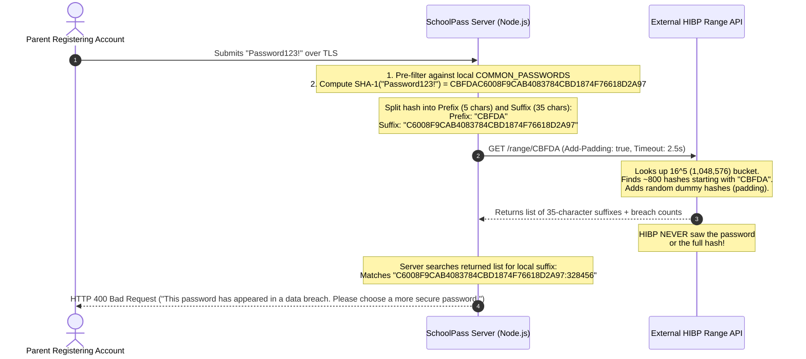

# Breached-Password Protection via k-Anonymity

**Document Version:** 1.0.0  
**Target Application:** SchoolPass (`C:\Users\gbola\Desktop\SchoolPass`)  
**Assessment Area:** Task 4 — Server Security and Data Integrity (Step 9)  
**Primary Source Code:** `src/lib/auth/passwordValidation.ts`, `src/lib/auth/index.ts`  
**Related Evidence:** `evidence/15-breach-check-rejection.png`  
**Date:** November 2, 2026  

---

## 1. Executive Summary

Password reuse is the single most pervasive human vulnerability in authentication security. When popular consumer services (e.g., LinkedIn, Adobe, Canva) suffer data breaches, attackers compile billions of leaked plaintext credentials into massive dictionary corpuses (such as `RockYou2024` or Have I Been Pwned's 900+ million entry database). Attackers then run automated credential stuffing attacks against newly discovered platforms like SchoolPass, correctly predicting that many parents and staff have reused their personal passwords.

To eliminate this attack vector at the registration boundary, SchoolPass integrates breached-password verification using the industry-standard **k-Anonymity mathematical model**.

This document details the cryptographic protocol behind k-anonymity, explains how SchoolPass checks for breaches without ever exposing the user's password, audits the fail-open timeout policy, and explains why naive breach-checking architectures are severe security and compliance violations.

---

## 2. The Cryptographic k-Anonymity Protocol

The core architectural dilemma of breached-password checking is: **How can a server verify whether a user's password exists in a remote database of 900+ million leaked passwords without revealing the password (or its full hash) to that external service?**

SchoolPass implements the k-Anonymity protocol created by Cloudflare and Troy Hunt (Have I Been Pwned / HIBP):



### 2.1 Mathematical Mechanics
1. **Full Hash Generation:**  
   The server takes the trimmed password and computes its cryptographic SHA-1 digest in uppercase hexadecimal format (40 hexadecimal characters):
   $$\text{SHA-1}("Password123!") = \mathbf{CBFDA}\text{C6008F9CAB4083784CBD1874F76618D2A97}$$
2. **Prefix Isolation (The Anonymity Set):**  
   The server extracts the first 5 hexadecimal characters:
   $$\text{Prefix} = \mathbf{CBFDA}$$
   Because each hexadecimal character has 16 possible values ($0-9, A-F$), a 5-character prefix spans $16^5 = 1,048,576$ possible buckets. Dividing a corpus of $\sim 900,000,000$ breached passwords across $\approx 1\text{ million}$ buckets results in an average bucket size of:
   $$k \approx \frac{900,000,000}{1,048,576} \approx \mathbf{858 \text{ entries per bucket}}$$
3. **Suffix Isolation:**  
   The remaining 35 characters are retained locally in memory:
   $$\text{Suffix} = \mathbf{C6008F9CAB4083784CBD1874F76618D2A97}$$
4. **Range Query:**  
   The server makes a secure HTTP GET request to `https://api.pwnedpasswords.com/range/CBFDA`.
5. **Local Suffix Matching:**  
   The API returns a plaintext list of $\approx 850$ suffixes and their observed breach counts. The SchoolPass server iterates over the list locally, comparing each returned suffix against its local suffix. If a match is found, the password is confirmed breached.

---

## 3. Why the Naive Version Is Unacceptable

The assessment brief prompts: *"Say why the naive version would be an unacceptable thing to build."*

A naive breach-check implementation would simply make a POST request transmitting the candidate password or its complete hash to an external API:
```typescript
// DANGEROUS ANTI-PATTERN: The Naive Breach Check
await fetch('https://api.breach-service.com/check', {
  method: 'POST',
  body: JSON.stringify({ password: userTypedPassword }), // CATASTROPHIC!
});
```

Building the naive version is an unacceptable engineering failure for four fundamental reasons:

### 3.1 Total Breach of User Confidentiality
Sending the plaintext password to any third-party service completely breaks the trust boundary. The third-party service operator (or an attacker with access to their web server access logs, reverse proxies, or cloud monitoring telemetry) now possesses the plaintext password that the user likely reuses across their personal banking, primary email, and government portals.

### 3.2 Violation of Data Privacy Regulations (NDPR & GDPR)
Under the Nigeria Data Protection Act (NDPA 2023) and global regulations (GDPR), plaintext passwords constitute sensitive personal authentication data. Transmitting plaintext credentials across organizational boundaries to an external third-party without cryptographic anonymization exposes the institution to severe legal penalties, regulatory audits, and mandatory breach disclosures.

### 3.3 The Full-Hash Fallacy
Some developers naively believe that sending the *full* SHA-1 hash (`CBFDAC6008F9CAB4083784CBD1874F76618D2A97`) is secure because "it is a hash, not plaintext." This is dangerously false:
- SHA-1 is a fast, un-salted digest.
- Massive precomputed rainbow tables exist for all known words and character combinations up to 12 characters.
- Anyone observing the full hash in third-party server logs can reverse it to the exact plaintext password within milliseconds.

### 3.4 Traffic Analysis & Response Padding (`Add-Padding`)
Even with 5-character prefixes, an attacker monitoring network packet sizes could theoretically observe the exact byte size of the returned response and infer which bucket was accessed. SchoolPass includes the header:
```http
Add-Padding: true
```
This instructs HIBP to inject random, synthetic hash suffixes with count `0` into the response body, standardizing packet sizes and defeating statistical traffic analysis.

---

## 4. Operational Resilience: The Fail-Open Policy

Primary Source: `src/lib/auth/passwordValidation.ts`

In production school administration, third-party network dependencies must never create single points of failure for core business workflows. If Have I Been Pwned experiences an outage, DNS failure, or DDoS attack, school parents must not be blocked from registering their children for the academic term.

### 4.1 Strict 2.5-Second Timeout
```typescript
const controller = new AbortController();
const timeoutId = setTimeout(() => controller.abort(), 2500);

const res = await fetch(targetUrl, {
  headers: {
    'User-Agent': 'SchoolPass-Security-Validator/1.0',
    'Add-Padding': 'true',
  },
  signal: controller.signal,
});
```
If the external API fails to respond within 2,500 ms, `controller.abort()` cancels the network socket immediately, preventing the parent registration request from stalling.

### 4.2 Fail-Open Architecture
```typescript
if (!res.ok) {
  // Fail-open on upstream HIBP API errors to prevent user lockout
  console.warn(`[HIBP] Breached password check returned status ${res.status}. Failing open per policy.`);
  return false; // Allows registration to proceed
}
```
If an upstream HTTP error (`500 Internal Server Error`, `503 Service Unavailable`, `429 Rate Limit`) or an `AbortError` occurs:
1. SchoolPass logs an audit warning: `[HIBP] Breached password check failed or timed out. Failing open per policy.`
2. The function returns `false` (indicating "not blocked").
3. Registration proceeds normally.

### 4.3 Defense-in-Depth: Local Common Dictionary Pre-Filter
To guarantee baseline security even during an HIBP network outage, SchoolPass maintains a local, in-memory `COMMON_PASSWORDS` Set containing common Nigerian and global dictionary passwords (`password123!`, `admin123!`, `schoolpass123!`, `12345678!`). This check executes synchronously in $<0.001\text{ ms}$ before any network call, guaranteeing that trivial passwords are rejected 100% of the time regardless of external network availability.
