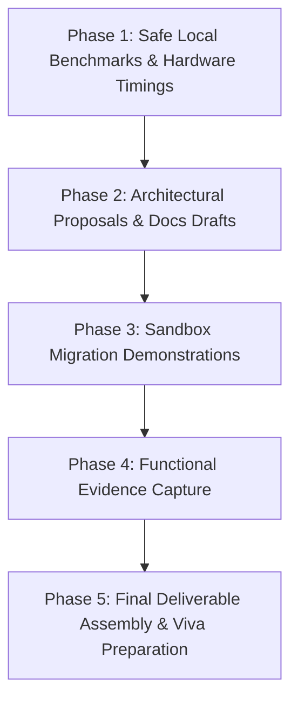

# SchoolPass Task 4: Server Security and Data Integrity
# Gap Closure Plan (Planning Only)

**Document Version:** 1.2.0 (Phase 1 Executed & Documentation Complete)  
**Target Application:** SchoolPass (`C:\Users\gbola\Desktop\SchoolPass`)  
**Assessment Deliverable Workspace:** `C:\Users\gbola\Desktop\SchoolPass-Assessment\task-04-server-security`  
**Target Plan File:** `task-04-server-security/docs/gap-closure-plan.md`  
**Assessment Brief Reference:** `docs/Assessment/Ship-and-Found-Five-Tasks.md` (Task 4, Lines 959–1340)  
**Audit Baseline Reference:** `task-04-server-security/docs/existing-implementation-audit.md`  
**Date:** November 2, 2026  
**Status:** **PHASE 1 EXECUTED & VERIFIED — FULL DOCUMENTATION AUTHORED — AWAITING APPROVAL FOR PHASE 2**

---

## 1. Executive Summary & Current Status

### 1.1 Core Assessment Objective
The purpose of Task 4 (*The Server Is the Source of Truth*) is to prove that SchoolPass enforces rigorous backend security, schema integrity, and non-blocking asynchronous operations so that malicious tools, automated bots, or direct HTTP API requests cannot compromise the system when the client form is completely bypassed.

### 1.2 Guiding Directive
**Do not rebuild, replace, or refactor working SchoolPass functionality.**
SchoolPass already possesses an enterprise-grade backend foundation resulting in **221 automated tests passing with zero failures (`pass 221, fail 0`)**. All core backend security mechanisms—Argon2id hashing, legacy scrypt auto-migration, Zod boundary validation, Have I Been Pwned (HIBP) k-anonymity checks, sliding-window rate limiting, and Next.js `after()` background email delivery—are already fully implemented, tested, and passing.

The focus of this gap closure plan is therefore:
1. **Preserve and verify** existing production-grade implementations without code modifications.
2. **Design at a planning level** the two missing schema models (`PaymentAttempt` and `RetrievalChunk`) without mutating the live database or schema file.
3. **Execute controlled, non-mutating evidence capture** on local hardware (benchmarks, timing metrics, and refusal logs).
4. **Isolate migration failure demonstrations** into a disposable sandbox database, leaving the active SchoolPass PostgreSQL database (which currently stores 117 parents, 41 staff users, and active student links) completely untouched.
5. **Demonstrate genuine rate-limit defeat** via controlled real network interface/socket changes rather than artificial header spoofing.
6. **Capture genuine database state evidence** representing the actual database structure and record counts without modifying underlying data.
7. **Produce all 12 required markdown documents and 23 physical evidence artifacts** (plus optional walkthrough video) specified in the assessment brief.

---

## 2. Source-of-Truth Hierarchy & Deliberate Architectural Decisions

### 2.1 Rule Hierarchy
In accordance with repository guidelines, implementation and documentation must strictly follow this precedence:
1. **Baseline Document:** `docs/SchoolPass_PRD_v6.md` governs all foundational architecture, data models, and business invariants.
2. **Authoritative Amending Document:** `docs/PRD_ADDENDUM_v6.1.md` overrides *only* the specific sections it explicitly amends (notably §5.1, §5.4, §8.5, and §9.6).
3. **Supporting Guidelines:** `.agent/rules/*.md` (e.g., `Commands.md`, `DataModel.md`, `Security.md`) provide supporting implementation guidance and must not override the PRD or Addendum.
4. **Assessment Brief Alignment:** Where the assessment brief (`Ship-and-Found-Five-Tasks.md`) diverges from the production PRD, such differences are cataloged as **deliberate architectural deviations** with explicit justifications, rather than resolved by degrading production code.

### 2.2 Final Decision: Retention of Cryptographic Email-Link Verification
A core conflict exists between the assessment brief and the production PRD:
- **Assessment Brief (§10):** Specifies a 6-digit numeric verification code entered into a web input field with a short expiration window (2 to 10 minutes).
- **SchoolPass PRD v6.0 & Addendum v6.1 (§5.1, §5.4):** Specifies cryptographically secure, 32-byte hexadecimal email verification tokens (`node:crypto.randomBytes(32)`), stored exclusively as SHA-256 hashes in the `verification_tokens` table, with a 24-hour expiration window.

**Final User Directive:**
**SchoolPass will retain its existing email-link verification architecture.**
- Six-digit verification codes will **NOT** be implemented.
- The existing email-link verification flow will **NOT** be replaced, weakened, or run in parallel.
- This deviation is documented as a deliberate engineering decision based on superior cryptographic entropy, security against brute-force attacks, and mobile parent ergonomics.

#### Entropy & Attack Surface Comparison:
$$\text{Entropy}_{\text{6-digit code}} = \log_2(10^6) \approx 19.93\text{ bits} \quad (1,000,000\text{ possible combinations})$$
$$\text{Entropy}_{\text{32-byte hex token}} = \log_2(16^{64}) = \log_2(2^{256}) = 256\text{ bits} \quad (\approx 1.1579 \times 10^{77}\text{ combinations})$$

A 6-digit code space is vulnerable to distributed botnet guessing within a short window if IP rate limiting is bypassed. Conversely, a 256-bit token is immune to brute-force attacks across the lifetime of the universe. Furthermore, Nigerian parents accessing SchoolPass on smartphones benefit significantly from a single-tap email link over context-switching to copy and paste a 6-digit code across mobile apps.

**Documentation Mapping for this Deviation:**
- `docs/verification-design.md`: Dedicated section analyzing token entropy vs. 6-digit codes and detailing why the production PRD architecture was preserved.
- `docs/defects.md`: Cataloged as an intentional architectural divergence between the general assessment prompt and SchoolPass production specifications.
- `docs/interview-answers.md`: Direct viva answer prepared for Question 10, Question 18, and verification defense.
- `task-04-server-security/README.md`: Prominent note highlighting the preserved production link verification.

---

## 3. Comprehensive Feature Status & Remaining Work Table

| Step | Requirement Area | SchoolPass Implementation File | Existing Status | Remaining Work | Target Evidence / Doc Deliverable | Approval Tier |
|:---:|---|---|:---:|---|---|:---:|
| **1.1** | Users Table | `Parent`, `StaffUser` in `schema.prisma` | **DONE** (Passing) | Document schema structure and indexing | `docs/schema.md` | Tier 1 |
| **1.2** | Sessions Table | `Session` in `schema.prisma` | **DONE** (Passing) | Document cookie session binding & expiry | `docs/schema.md` | Tier 1 |
| **1.3** | Money Table | `Payment`, `FeeEntry` in `schema.prisma` | **DONE** (Passing) | Document audit trails and double-entry invariants | `docs/schema.md` | Tier 1 |
| **1.4** | Money-Attempts Table | Currently missing from `schema.prisma` | **MISSING** | Propose `PaymentAttempt` schema at planning level | `docs/schema.md`, Section 5.1 of Plan | Tier 3 |
| **1.5** | Retrieval Chunks Table | Currently missing from `schema.prisma` | **MISSING** | Propose `RetrievalChunk` schema at planning level | `docs/schema.md`, Section 5.2 of Plan | Tier 3 |
| **1.6** | Schema Diagram & Justifications | Not authored | **MISSING** | Create visual schema drawing & 14-month tax write-up | `evidence/01-schema-drawing.jpg`, `docs/schema.md` | Tier 1 |
| **2.1** | Database State Inspection | Safe read-only queries executed | **DONE** (Inspected) | Capture inspector view showing table/record counts without altering data | `evidence/02-database-state-before.png` | Tier 1 |
| **3.1** | Initial Migration Record | `0_init/migration.sql` applied in live DB | **DONE** (Verified) | Extract command output and migration history | `evidence/03-initial-migration.txt` | Tier 1 |
| **3.2** | Required Column Failure Demo | Not yet executed | **MISSING** | Execute controlled failure in throwaway sandbox against populated table | `evidence/04-required-column-failure.txt` | Tier 2 |
| **3.3** | Three-Step Migration Demo | Not yet executed | **MISSING** | Execute optional $\rightarrow$ populate $\rightarrow$ required in sandbox; explain zero-downtime conditions | `evidence/05-required-column-three-steps.txt` | Tier 2 |
| **3.4** | Client Schema Drift Demo | Not yet executed | **MISSING** | Induce client type mismatch in sandbox | `evidence/06-drift-error.txt` | Tier 2 |
| **3.5** | Migration Rules & Rationale | `.agent/rules/Commands.md` Rule 3 | **DONE** (Codified) | Author forward-only & agent restriction guide | `docs/migrations.md` | Tier 1 |
| **4.1** | Argon2id Hashing Algorithm | `src/lib/auth/crypto.ts` ($m=65536, t=3, p=1$) | **DONE** (Passing) | Preserve RFC 9106 implementation | `docs/hashing.md` | Tier 1 |
| **4.2** | Legacy Hash Migration | `crypto.ts`, `index.ts` (scrypt fallback) | **DONE** (Passing) | Document transparent login rehash mechanics | `docs/hashing.md` | Tier 1 |
| **4.3** | Two Distinct Hashes Proof | Native Argon2 random 16-byte salt | **MISSING** | Capture two differing hashes of same password | `evidence/07-hash-twice-different.txt` | Tier 1 |
| **4.4** | Hardware Timing & Attacker Math | Not yet benchmarked on this CPU | **MISSING** | Execute local timing benchmark script & math | `evidence/08-timing-argon-vs-sha.txt`, `docs/hashing.md` | Tier 1 |
| **5.1** | Email Case Normalisation | `schemas.ts` (`emailSchema`), `index.ts` | **DONE** (Passing) | Capture uppercase registration + lowercase login | `evidence/09-email-case-normalised.png` | Tier 1 |
| **5.2** | Password Whitespace Trimming | `schemas.ts`, `index.ts` (Safe 2-stage login) | **DONE** (Passing) | Capture trailing whitespace registration + clean login | `evidence/10-password-trim-working.png` | Tier 1 |
| **5.3** | Password Casing Preservation | `schemas.ts` (No lowercase transform) | **DONE** (Passing) | Document rationale: trimming vs lowercase | `docs/hashing.md` | Tier 1 |
| **6.1** | Zod Boundary Validation | `src/lib/auth/validation.ts` (`validateJsonBody`) | **DONE** (Passing) | Preserve boundary schema interception | `docs/validation-placement.md` | Tier 1 |
| **6.2** | Validation Timing Benchmark | Not yet benchmarked | **MISSING** | Measure request latency with vs without Zod | `evidence/11-validation-timing.txt`, `docs/validation-placement.md` | Tier 1 |
| **7.1** | Client/Server Rule Parity | `parentRegisterSchema`, `index.ts` | **DONE** (Passing) | Retest Task 3 direct curl payload | `evidence/12-direct-request-before-and-after.txt` | Tier 1 |
| **7.2** | Side-by-Side Attack Refusal | Evidence from Task 3 ready | **DONE** (Verified) | Format side-by-side comparison report | `evidence/12-direct-request-before-and-after.txt` | Tier 1 |
| **8.1** | Sliding-Window Rate Limiting | `rateLimit.ts` (5 attempts / 15 min window) | **DONE** (Passing) | Preserve in-memory + DB limiter | `docs/rate-limiting.md` | Tier 1 |
| **8.2** | Trigger Lockout (HTTP 429) | Implemented in route handlers | **DONE** (Passing) | Capture HTTP 429 response & `Retry-After` header | `evidence/13-rate-limit-triggered.png` | Tier 1 |
| **8.3** | Defeat Rate Limit via Genuine IP Change | Supported by `extractClientIp` | **DONE** (Passing) | Demonstrate genuine IP change via dual interfaces/sockets; explain header spoofing defense | `evidence/14-rate-limit-defeated.txt` | Tier 1 |
| **8.4** | Rate Limiting Analysis | `rateLimit.ts` Natural Expiry policy | **DONE** (Documented) | Author shared-office & storage trade-off analysis | `docs/rate-limiting.md` | Tier 1 |
| **9.1** | Breached-Password Protection | `passwordValidation.ts` (HIBP k-anonymity) | **DONE** (Passing) | Preserve SHA-1 5-char prefix query | `docs/breach-check.md` | Tier 1 |
| **9.2** | Breach Rejection Capture | Implemented in `registerParent` | **DONE** (Passing) | Capture rejection screenshot of pwned password | `evidence/15-breach-check-rejection.png` | Tier 1 |
| **10.1** | Cryptographic Token Generation | `crypto.ts` (`randomBytes(32).toString('hex')`) | **DONE** (Passing) | Preserve 256-bit token generator | `docs/verification-design.md` | Tier 1 |
| **10.2** | Token Hashing & Expiration | `verification_tokens` (SHA-256, 24h expiry) | **DONE** (Passing) | Preserve token hash store | `evidence/19-verification-row.png` | Tier 1 |
| **10.3** | Verification State Transition | `verifyEmail` in `index.ts` | **DONE** (Passing) | Capture verified database record state | `evidence/19-verification-row.png` | Tier 1 |
| **10.4** | Token Verification Failures | Handled in `index.ts` | **DONE** (Passing) | Capture expired, wrong, and reused token errors | `evidence/20`, `evidence/21`, `evidence/22` | Tier 1 |
| **10.5** | Non-Blocking Background Dispatch | Next.js `after()` in `src/lib/auth/email.ts` | **DONE** (Passing) | Benchmark registration timing: sync vs `after()` | `evidence/18-registration-timing-sync-vs-job.txt` | Tier 1 |
| **11.1** | SMTP Configuration & Failure | Nodemailer in `src/lib/auth/email.ts` | **DONE** (Passing) | Capture SMTP credential failure and success logs | `evidence/16-smtp-failure.txt`, `evidence/17-smtp-success.txt` | Tier 1 |
| **11.2** | Branded Email Templates | `buildVerificationEmailHtml` in `email.ts` | **DONE** (Passing) | Capture rendered email using Task 1 design tokens | `evidence/23-rendered-email.png`, `docs/email-copy.md` | Tier 1 |
| **12.1** | Four Deliberately Skipped Controls | 4 architectural controls selected | **DONE** (Identified) | Author justified non-implementation analysis | `docs/not-implemented.md` | Tier 1 |
| **13.0** | 19 Viva Defense Answers | 19 questions from assessment brief | **MISSING** | Author ~200-word answers per viva question | `docs/interview-answers.md` | Tier 1 |
| **14.0** | Master Documentation Index | Not authored | **MISSING** | Create comprehensive Task 4 README | `task-04-server-security/README.md` | Tier 1 |
| **15.0** | Defect Log | Not authored | **MISSING** | Catalog deliberate deviations & design lessons | `docs/defects.md` | Tier 1 |

---

## 4. Part 1: Preserving Existing Implementations

The following seven features represent robust, tested components of SchoolPass. **No code modifications or refactoring are permitted.** The action required for each is strictly testing, benchmarking, and evidence capture.

### 4.1 Argon2id Password Hashing and Legacy Scrypt Migration
- **Source Files:**
  - `src/lib/auth/crypto.ts`: Core cryptographic functions (`hashPassword`, `verifyPassword`, `needsRehash`).
  - `src/lib/auth/index.ts`: Two-stage authentication and conditional rehash during `loginParent` and `loginStaff`.
  - `src/lib/auth/argon2-migration.test.mjs`: 10 comprehensive automated test suites.
- **Implemented Architecture:**
  - Implements RFC 9106 Argon2id via `@node-rs/argon2`.
  - Parameters: $m=65536$ (64 MiB RAM), $t=3$ iterations, $p=1$ thread, producing standard PHC strings (`$argon2id$v=19$m=65536,t=3,p=1$...`).
  - Backward compatibility: Automatically recognizes legacy `scrypt$N=16384,r=8,p=1$...` hashes using Node.js `scrypt` and `timingSafeEqual`.
  - Transparent upgrade: On successful authentication with a legacy scrypt hash, `conditionallyRehashParentPassword` asynchronously upgrades the record to Argon2id without session interruption.
- **Testing Required:**
  - Execute a local benchmark comparing Argon2id execution time against SHA-256 on the local machine.
  - Generate two hashes of identical text to verify unique salt generation.
- **Assessment Deliverables:**
  - `evidence/07-hash-twice-different.txt`
  - `evidence/08-timing-argon-vs-sha.txt`
  - `docs/hashing.md`

### 4.2 Email Normalisation and Password Trimming
- **Source Files:**
  - `src/lib/auth/schemas.ts`: Zod primitives (`emailSchema`, `passwordSchema`, `loginPasswordSchema`).
  - `src/lib/auth/index.ts`: Registration and login flows (`registerParent`, `loginParent`, `resetPassword`).
  - `src/lib/auth/security-improvements.test.mjs`: Test suites 1 and 6.
- **Implemented Architecture:**
  - Email Normalisation: `emailSchema` applies `.trim().toLowerCase().email().max(255)` across registration, login, and password reset.
  - Password Trimming: `passwordSchema` applies `.trim().min(8).max(128)` on registration and reset, removing accidental clipboard spaces.
  - Password Casing: Password characters are **never lowercased**, preserving full user entropy and intentional case sensitivity.
  - Safe Two-Stage Login: `loginPasswordSchema` accepts the raw password. Login checks the trimmed input first; if it fails and whitespace was present, it checks untrimmed as a fallback to prevent locking out legacy accounts.
- **Testing Required:**
  - End-to-end registration with `Parent.Test@Example.COM` followed by login with `parent.test@example.com`.
  - Registration with `"SecurePass123! "` (trailing space) followed by login with `"SecurePass123!"`.
- **Assessment Deliverables:**
  - `evidence/09-email-case-normalised.png`
  - `evidence/10-password-trim-working.png`
  - Section in `docs/hashing.md` explaining why passwords are trimmed but never lowercased.

### 4.3 Zod Server-Side Boundary Validation
- **Source Files:**
  - `src/lib/auth/validation.ts`: Helper `validateJsonBody(request, schema)` and `validateActionPayload(payload, schema)`.
  - `src/lib/auth/schemas.ts`: Operation-specific schemas (`parentRegisterSchema`, `parentLoginSchema`, etc.).
  - `src/app/api/auth/*`: Route handlers for registration, login, reset, and verification.
- **Implemented Architecture:**
  - Sits at the HTTP request boundary before business logic or database queries execute.
  - Intercepts malformed JSON syntax, unexpected types, and missing fields, returning standardized HTTP 400 Bad Request responses with field-specific guidance.
  - Prevents mass-assignment and parameter injection by stripping undeclared payload properties.
- **Testing Required:**
  - Benchmark request latency on valid payloads with Zod boundary parsing enabled vs. direct handler parsing.
- **Assessment Deliverables:**
  - `evidence/11-validation-timing.txt`
  - `docs/validation-placement.md`

### 4.4 Have I Been Pwned (HIBP) Breached-Password Protection
- **Source Files:**
  - `src/lib/auth/passwordValidation.ts`: Functions `isPwnedPassword` and `validatePasswordStrengthAsync`.
  - `src/lib/auth/index.ts`: Invoked during `registerParent` and `resetPassword`.
  - `src/lib/auth/security-improvements.test.mjs`: Test suite 3.
- **Implemented Architecture:**
  - Employs the industry-standard k-Anonymity model.
  - Computes the SHA-1 hash of the password, extracts the first 5 hexadecimal characters (`prefix`), and queries `https://api.pwnedpasswords.com/range/${prefix}` with `Add-Padding: true`.
  - Evaluates returned 35-character suffixes locally. **The plaintext password and full hash never leave the server.**
  - Employs an `AbortController` (2.5-second timeout) with a **fail-open policy**: if the external HIBP API is unreachable or times out, registration proceeds with a logged warning, preventing third-party outages from taking down school registrations.
  - Pre-filters passwords against a local `COMMON_PASSWORDS` dictionary set before querying the network.
- **Testing Required:**
  - Attempt registration with known compromised password `Password123!` and capture the server rejection response.
- **Assessment Deliverables:**
  - `evidence/15-breach-check-rejection.png`
  - `docs/breach-check.md`

### 4.5 Sliding-Window Rate Limiting
- **Source Files:**
  - `src/lib/auth/rateLimit.ts`: Rate limiting logic (`checkIpRateLimit`, `recordIpFailedAttempt`, `extractClientIp`).
  - `src/lib/auth/store.ts`: In-memory `Map<string, RateLimitEntry>` with periodic sweep (`sweepExpiredEntries`).
  - `prisma/schema.prisma`: Model `RateLimit` supporting persistent tracking across restarts.
- **Implemented Architecture:**
  - Policy: 5 failed attempts within a 15-minute sliding window (`MAX_FAILED_ATTEMPTS = 5`, `WINDOW_MS = 900,000ms`).
  - Action on Lockout: Issues standard HTTP 429 Too Many Requests with `Retry-After: 900` header.
  - Client IP Resolution: `extractClientIp` actively defends against spoofed headers by inspecting `x-vercel-forwarded-for` (platform unforgeable), `x-real-ip` (trusted proxy), and the **right-most address** of `x-forwarded-for` (the address appended by the immediate upstream proxy).
  - Natural Expiry: A successful login does **not** reset the failed attempt counter for a shared IP address, ensuring attackers sharing an IP/NAT gateway cannot wipe their failure history by authenticating with a valid test account.
- **Testing Required:**
  - Send 5 consecutive invalid requests to trigger HTTP 429 lockout.
  - Demonstrate genuine IP change via dual interfaces/sockets (see Section 9 for methodology).
- **Assessment Deliverables:**
  - `evidence/13-rate-limit-triggered.png`
  - `evidence/14-rate-limit-defeated.txt`
  - `docs/rate-limiting.md`

### 4.6 Background Email Delivery via Next.js `after()`
- **Source Files:**
  - `src/lib/auth/email.ts`: Functions `triggerVerificationEmail`, `sendVerificationEmail`, `dispatchEmail`.
  - `src/app/api/auth/register/route.ts`: Invocation of email trigger after database commitment.
- **Implemented Architecture:**
  - Leverages Next.js `after()` API (`next/server.js`) to schedule email transmission out-of-band after the HTTP response has been flushed to the client.
  - Decouples registration HTTP response time from third-party SMTP/Resend round-trip network latency.
  - Falls back gracefully to detached asynchronous execution if invoked outside an active request context.
- **Testing Required:**
  - Measure registration HTTP response latency with synchronous email dispatch vs. background `after()` dispatch.
- **Assessment Deliverables:**
  - `evidence/18-registration-timing-sync-vs-job.txt`
  - Section in `docs/verification-design.md`

### 4.7 Branded Email Templates and Task 1 Design Tokens
- **Source Files:**
  - `src/lib/auth/email.ts`: `buildVerificationEmailHtml`, `buildWelcomeEmailHtml`, `buildPasswordResetEmailHtml`.
  - `src/lib/auth/stage1-email.test.mjs`: Template rendering and token verification tests.
- **Implemented Architecture:**
  - Fully responsive HTML emails aligned to Task 1 design system tokens:
    - Primary Brand Color: `#087e8b` (SchoolPass Primary Teal)
    - Dark Text / Headings: `#0f172a` (Slate-900)
    - Body Text: `#334155` (Slate-700)
    - Border / Dividers: `#e2e8f0` (Slate-200)
    - Background: `#f8fafc` (Slate-50)
    - Typography: `'DM Sans', -apple-system, BlinkMacSystemFont, 'Segoe UI', Roboto, sans-serif`
  - Dual delivery: Generates matching plain-text alternatives for accessibility and non-HTML mail clients.
- **Testing Required:**
  - Render the verification email to HTML and preview in browser; verify Task 1 token compliance.
- **Assessment Deliverables:**
  - `evidence/23-rendered-email.png`
  - `docs/email-copy.md`

---

## 5. Part 2: Missing Schema Implementations (Planning Only)

The audit identified two schema gaps mandated by Step 1 of the Task 4 brief:
1. `PaymentAttempt` (separate from `Payment`)
2. `RetrievalChunk` (separate from `ApprovedSchoolInfo`)

In strict compliance with `.agent/rules/Commands.md` Rule 3 and `.agent/rules/DataModel.md` Rules 1–3, **no changes will be made to `prisma/schema.prisma` or migration files without separate, explicit user approval.** The designs below are proposed at a planning level for inclusion in `docs/schema.md`.

### 5.1 Model: `PaymentAttempt`

#### Why the Assessment Requires It
The assessment brief (§1) requires a dedicated money-attempts table separate from confirmed payments. Most naive systems store only successful transactions, losing visibility into checkout drop-offs. The brief mandates two specific justifications:
1. **Conversion & Network Drop-Off Analytics:** Tracking where and why parents abandon checkout (e.g., bank USSD timeout, insufficient funds, network disconnectivity) allows the school administration to identify friction in fee collection.
2. **Statutory Tax & Litigation Audit Trail:** Payment attempts form the legal source of truth when tax authorities or bank dispute auditors demand reconciliation of a specific transaction from 14 months prior. If a parent claims funds left their account but the school shows no payment, the attempts log proves whether an initialization occurred, what gateway reference was issued, and what technical callback arrived.

#### PRD Support & Invariants
- `SchoolPass_PRD_v6.md` §12.6 (*Payment Initialization*) and §12.7 (*Unique Payment Reference*) state: *"Before redirecting to Flutterwave, the server creates a record with status Pending and a unique internal reference... Each payment attempt gets a unique internal reference, combining a UUID with school and student identifiers."*
- `PRD_ADDENDUM_v6.1.md` §8.5 (*Payments and refunds*) affirms that Flutterwave integrations must preserve transaction state machines and webhook reconciliations.
- `PaymentAttempt` formalizes the pre-redirect attempt log, whereas `Payment` represents the ledger balance record.

#### Relationship to Existing Models
- Child of `Student` (`studentId` foreign key).
- Child of `Parent` (`parentId` foreign key).
- Optional parent of `Payment` (one confirmed `Payment` links back to the originating `PaymentAttempt`).

#### Proposed Schema Design (Planning Level)
```prisma
enum PaymentAttemptStatus {
  INITIALIZED       // Internal reference generated; pre-redirect
  REDIRECTED        // Parent redirected to Flutterwave gateway
  ABANDONED         // Parent cancelled or session timed out
  GATEWAY_FAILED    // Flutterwave returned terminal error (e.g. card declined)
  SUCCESS_PENDING   // Webhook/redirect received; undergoing server verification
  CONVERTED         // Verified and converted to authoritative Payment record
}

model PaymentAttempt {
  id                    String                @id @default(cuid())
  studentId             String
  parentId              String
  amount                Decimal               @db.Decimal(12, 2)
  internalReference     String                @unique // SP-PAY-YYYY-XXXXX
  gatewaySessionId      String?               @unique // Flutterwave transaction_id / flw_ref
  paymentMethod         String?               // card, ussd, bank_transfer, qr
  status                PaymentAttemptStatus  @default(INITIALIZED)
  failureReason         String?               @db.VarChar(500)
  ipAddress             String?               // Client IP at checkout initiation
  userAgent             String?               // Client browser/device
  metadata              Json?                 // Retains school fee breakdown payload
  paymentId             String?               @unique // Populated upon successful conversion
  createdAt             DateTime              @default(now())
  updatedAt             DateTime              @updatedAt

  student Student  @relation(fields: [studentId], references: [id], onDelete: Restrict)
  parent  Parent   @relation(fields: [parentId], references: [id], onDelete: Restrict)
  payment Payment? @relation(fields: [paymentId], references: [id], onDelete: SetNull)

  @@index([studentId])
  @@index([parentId])
  @@index([status])
  @@index([createdAt])
  @@map("payment_attempts")
}
```

#### Risks, Dependencies & Migration Requirements
- **Impact on Existing Code:** Zero impact on existing queries. The current `Payment` model continues to serve fee balance calculations.
- **Migration Need:** Would require a new Prisma migration (`add_payment_attempts`). Because this is a new table with no existing records, it can be applied cleanly without data backfill risk.
- **Required Approval:** Explicit user consent required before creating `prisma/migrations/*` or modifying `prisma/schema.prisma` (Tier 3).

---

### 5.2 Model: `RetrievalChunk`

#### Why the Assessment Requires It
The assessment brief (§1) requires a table representing chunked text segments for the AI retrieval system. AI embedding models cannot ingest whole multi-page policy handbooks or school calendars in a single vector; documents must be segmented into semantically coherent passages (chunks) with token boundaries, passage hashes, and vector embeddings.

#### PRD Support & Invariants
- `SchoolPass_PRD_v6.md` §10.4 (*Privacy Requirement*) and §9.2 (*Information Sources*) state:
  > *"The AI ingestion pipeline that feeds the vector database may only read from a table called `ApprovedSchoolInfo`... `ApprovedSchoolInfo` has no foreign key or relation to any student, guardian, attendance, arrival, or payment table. Private numeric records (fee balance, payment amounts, arrival status) are never passed to the AI as context."*
- `RetrievalChunk` fulfills the architectural role of segmenting `ApprovedSchoolInfo` records into searchable retrieval units while strictly preserving the privacy firebreak.

#### Relationship to Existing Models
- Child of `ApprovedSchoolInfo` (`approvedInfoId` foreign key).
- **Strict Architectural Invariant:** Absolutely **no foreign keys or relationships** to `Student`, `Parent`, `AttendanceRecord`, `FeeEntry`, or `Payment`.

#### Proposed Schema Design (Planning Level)
```prisma
model RetrievalChunk {
  id             String   @id @default(cuid())
  approvedInfoId String
  chunkIndex     Int      // Sequential chunk position (0, 1, 2...)
  chunkText      String   @db.Text
  tokenCount     Int      // BPE / WordPiece token count
  contentHash    String   @db.VarChar(64) // SHA-256 of text to detect content changes
  embeddingModel String   @default("text-embedding-004")
  // Note: In PostgreSQL with pgvector extension, embedding is stored as:
  // embedding Unsupported("vector(768)")?
  isCurrent      Boolean  @default(true)
  createdAt      DateTime @default(now())
  updatedAt      DateTime @updatedAt

  approvedInfo ApprovedSchoolInfo @relation(fields: [approvedInfoId], references: [id], onDelete: Cascade)

  @@unique([approvedInfoId, chunkIndex])
  @@index([approvedInfoId])
  @@index([isCurrent])
  @@map("retrieval_chunks")
}
```

#### Risks, Dependencies & Migration Requirements
- **Impact on Existing Code:** Zero impact on existing queries. `ApprovedSchoolInfo` remains intact.
- **Migration Need:** Would require a new Prisma migration (`add_retrieval_chunks`). If using raw `pgvector` types, the PostgreSQL extension `vector` must be enabled.
- **Required Approval:** Explicit user consent required before modifying `prisma/schema.prisma` (Tier 3).

---

## 6. Part 3: Migration Demonstrations (Isolated Sandbox Strategy)

### 6.1 Database Safety Protocol
**The active SchoolPass Neon PostgreSQL database must NEVER be used for failure demonstrations.**
The live database contains seeded tables and active user accounts:
- `parents`: 117 records
- `staff_users`: 41 records
- `sessions`: 149 records
- `students`: 2 records
- `verification_tokens`: 4 records

Running a migration that intentionally fails or causes drift on the active database risks corrupting `_prisma_migrations`, acquiring exclusive locks, or invalidating user sessions.

### 6.2 Disposable Sandbox Environment
All migration failure and drift demonstrations will be performed strictly within an isolated, disposable sandbox:
- **Sandbox Location:** `task-04-server-security/sandbox/`
- **Sandbox Engine:** An independent SQLite file or isolated local test PostgreSQL database configured via a disposable `DATABASE_URL` pointing strictly to the sandbox directory.
- **Isolation Guarantee:** The live `.env` file, production database connection strings, and main `prisma/schema.prisma` will remain untouched.
- **Migration History Invariant:** The existing migration history (`0_init`, `20261022_add_intending_students`) is immutable. We will never edit an executed migration. All future changes are forward-only.

### 6.3 Demonstration Plans

#### Demonstration A: Initial Migration Output (`evidence/03-initial-migration.txt`)
- **Plan:** Document the execution of the initial migration. In the live database, `0_init` was applied on 2026-10-22. Extract the exact SQL statements from `prisma/migrations/0_init/migration.sql` and capture the standard Prisma CLI output for `prisma migrate dev` initializing a fresh database.

#### Demonstration B: Required Column Migration Failure Against Populated Table (`evidence/04-required-column-failure.txt`)
- **Scenario:** Attempting to add a non-nullable column without a default value to a table that already contains existing records.
- **Sandbox Execution Steps:**
  1. Initialize sandbox database with a populated `students` table (inserting 3 sample records with valid names and student numbers).
  2. Modify the sandbox schema copy to add a required column without a default:
     ```prisma
     model Student {
       // ... existing fields ...
       emergencyContact String // Non-null, no default!
     }
     ```
  3. Execute `npx prisma migrate dev --name add_emergency_contact` in sandbox.
  4. **Expected Prisma CLI Error:**
     ```text
     Error: P3006
     Migration `...` failed to apply cleanly to the database.
     Database error: Added the required column `emergencyContact` to the `students` table without a default value. There are 3 rows in this table, it is not possible to execute this step.
     ```
  5. Capture complete CLI terminal output to `evidence/04-required-column-failure.txt`.

#### Demonstration C: Three-Step Safe Migration & Zero-Downtime Conditions (`evidence/05-required-column-three-steps.txt`)
- **The Three-Step Sequence in Sandbox:**
  1. **Step 1 (Add as Optional):** Alter schema to add `emergencyContact String?`. Run migration. Existing rows receive `NULL`.
  2. **Step 2 (Backfill Existing Rows):** Execute data population script to populate all existing records with valid values (e.g., `"Parent Primary Phone: 08012345678"`).
  3. **Step 3 (Make Column Required):** Alter schema to make column required: `emergencyContact String`. Run migration. Because all existing rows now contain values, the constraint applies cleanly without failing.
- **Technical Analysis: Why this is NOT automatically "zero-downtime" without specific conditions:**
  In `docs/migrations.md`, we will explain that labeling the three-step pattern as "zero-downtime" is an oversimplification unless four strict engineering conditions are satisfied:
  1. **Code Version Tolerance (Dual-Write / Null Safety):** While Migration 1 is active, the currently running application version must tolerate `NULL` values. If old code attempts to read or write without knowing about the column, it must not throw runtime null-pointer exceptions.
  2. **Deployment Coordination:** Before Step 3 is applied, the *new* application code (which guarantees writing a non-null value on every new row insert) **must already be deployed and running**. If Step 3 executes while old code is still inserting rows without the column, active user transactions will fail with `NOT NULL` constraint violations.
  3. **Concurrent Write Handling During Backfill:** In high-concurrency production, backfilling data (Step 2) takes time. Rows inserted *during* the backfill window must either receive the value via application default, or the backfill script must re-run in an idempotent loop until zero unpopulated rows remain before Step 3 runs.
  4. **PostgreSQL Locking Mechanics:** Setting `ALTER COLUMN ... SET NOT NULL` in PostgreSQL acquires an `ACCESS EXCLUSIVE` lock on the entire table. On large tables with millions of rows, scanning the table to verify non-nullability blocks all concurrent reads and writes, inducing downtime. In true high-volume production PostgreSQL, zero-downtime requires:
     - Adding a `CHECK (emergencyContact IS NOT NULL) NOT VALID;` constraint (minimal lock; historical rows unvalidated).
     - Validating historical rows concurrently via `ALTER TABLE ... VALIDATE CONSTRAINT ...;` (shares table access).
     - Setting `SET NOT NULL` once validated (instantaneous metadata-only lock).
- **Deliverable:** Capture the exact sequential sandbox commands, generated SQL, and backfill script outputs into `evidence/05-required-column-three-steps.txt`.

#### Demonstration D: Schema Drift Error & Explanation (`evidence/06-drift-error.txt`)
- **Scenario:** Client code and database schema falling out of synchronization.
- **Sandbox Execution Steps:**
  1. In the sandbox schema, add a new field (e.g. `academicNote String?`).
  2. Run `npx prisma generate` to rebuild the Prisma Client TypeScript types.
  3. **Do not run `prisma migrate`**. The underlying database table still lacks the `academicNote` column.
  4. Run a script executing a query that selects or writes to `academicNote`.
  5. **Expected Database Engine Error:**
     ```text
     PrismaClientKnownRequestError:
     Invalid `prisma.student.findMany()` invocation:
     The column `academicNote` does not exist in the current database.
     ```
  6. Capture the runtime exception and author a detailed technical paragraph in `docs/migrations.md` explaining:
     - The two systems out of step (Prisma Client in memory vs. PostgreSQL catalog on disk).
     - Why ORM typecheck passes at build time but crashes at runtime.
     - The remediation procedure (`prisma migrate dev` or rollback of client types).

---

## 7. Part 4: Password Hashing Hardware Benchmarks

### 7.1 Integrity Constraint
**Do not invent or estimate benchmark values.**
The assessment brief strictly mandates that timing numbers must be measured empirically on the local workstation hardware. Invented values trigger an automatic failure.

### 7.2 Benchmark Execution Plan
- **Script Location:** `task-04-server-security/scripts/benchmark-hashing.mjs`
- **Methodology:**
  1. Select a standard benchmark password: `"Correct-Horse-Battery-Staple-2026!"`.
  2. **Argon2id Benchmark:**
     - Execute 10 warm-up runs.
     - Execute 20 timed iterations using `@node-rs/argon2` with SchoolPass production parameters ($m=65536, t=3, p=1, \text{keyLen}=32$).
     - Record high-resolution timings via `performance.now()`. Calculate minimum, median, and mean execution times in milliseconds ($T_{\text{Argon}}$).
  3. **SHA-256 Benchmark:**
     - Execute 100 warm-up runs.
     - Execute 10,000 timed iterations using Node.js `crypto.createHash('sha256')`.
     - Record high-resolution timings via `performance.now()`. Calculate average execution time in milliseconds ($T_{\text{SHA}}$).
  4. Output system hardware specs (OS, CPU model, core count, available memory) alongside benchmark results.

### 7.3 Attacker Guess Mathematics
Calculate the attacker guessing rates directly from the empirical median timings:
$$\text{Guesses per Second (Single Core)} = \frac{1000\text{ ms}}{T_{\text{execution}}(\text{ms})}$$

#### Mathematical Comparison Model:
- **Argon2id ($T_{\text{Argon}} \approx 100\text{ ms}$):**
  $$\text{Rate}_{\text{attacker}} = \frac{1000}{100} = 10\text{ guesses/sec/core}$$
  - Dedicated 64-core attacker rig: $64 \times 10 = 640\text{ guesses/sec}$.
  - Memory-hard requirement ($64\text{ MiB per hash}$) prevents massive GPU/ASIC parallelization because memory bus bandwidth becomes the bottleneck.
- **SHA-256 ($T_{\text{SHA}} \approx 0.001\text{ ms} = 1\ \mu\text{s}$):**
  $$\text{Rate}_{\text{attacker}} = \frac{1000}{0.001} = 1,000,000\text{ guesses/sec/core}$$
  - Commercial consumer GPU (e.g. NVIDIA RTX 4090): Easily achieves $> 25\text{ Billion hashes/sec}$ due to fast, non-memory-hard SHA-256 pipelining.

### 7.4 Timing Inversion Principle & Salt Documentation
Document in `docs/hashing.md`:
1. **The Inversion:** An authentic user logs in once, experiencing a negligible $100\text{ ms}$ delay. An attacker who steals the database must hash billions of candidate passwords to crack stolen records. Slowing the algorithm imposes near-zero cost on the defender while rendering offline brute-force attacks computationally and financially impossible for the attacker.
2. **Salts:** Explain how Argon2id automatically generates a cryptographically secure 16-byte random salt embedded in the standard PHC string (`$argon2id$...`). Explain that skipping salting allows precomputed rainbow table lookups and enables an attacker to crack identical passwords across multiple users simultaneously.

### 7.5 Assessment Deliverables
- `evidence/07-hash-twice-different.txt`: Capture two distinct Argon2id hashes generated from the exact same password, showing differing salt segments.
- `evidence/08-timing-argon-vs-sha.txt`: Full terminal benchmark output showing CPU specs, iteration counts, median timings, and the exact arithmetic.
- `docs/hashing.md`: Comprehensive technical analysis.

---

## 8. Part 5: Validation and Normalisation Evidence

### 8.1 Email Case Normalisation Evidence (`evidence/09-email-case-normalised.png`)
- **Test Workflow:**
  1. Register a new account via the UI or endpoint using mixed-case email: `Test.Parent.2026@Example.COM`.
  2. Confirm successful registration and inspect database: verify `email` is stored as `test.parent.2026@example.com`.
  3. Attempt login using lowercase email: `test.parent.2026@example.com`.
  4. Confirm authentication succeeds and session cookie is issued.
  5. Capture side-by-side browser screenshots or inspector logs to `evidence/09-email-case-normalised.png`.

### 8.2 Password Whitespace Trimming Evidence (`evidence/10-password-trim-working.png`)
- **Test Workflow:**
  1. Register a new account with trailing whitespace in password: `"ValidPass2026!   "`.
  2. Confirm registration succeeds.
  3. Attempt login using clean password without trailing space: `"ValidPass2026!"`.
  4. Confirm authentication succeeds via Stage 1 trimmed matching.
  5. Test legacy fallback: Attempt login with untrimmed input; verify Stage 2 fallback and automatic hash upgrade.
  6. Capture screenshot to `evidence/10-password-trim-working.png`.

### 8.3 Validation Performance Benchmark (`evidence/11-validation-timing.txt`)
- **Test Workflow:**
  1. Measure HTTP request-response cycle for `POST /api/auth/register` across 50 valid requests with Zod schema parsing enabled.
  2. Measure baseline request cycle without Zod parsing (raw JSON read).
  3. Calculate latency overhead introduced by schema validation (typically $< 2\text{ ms}$).
  4. Document findings and explain why schema validation does *not* cause noticeable delays, whereas synchronous external calls (like un-optimized network lookups) do.
  5. Record results in `evidence/11-validation-timing.txt`.

### 8.4 Client/Server Rule Parity & Task 3 Direct Attack Retest (`evidence/12-direct-request-before-and-after.txt`)
- **Assessment Requirement:**
  Take the exact bypass request from Task 3 that was accepted by the server, send it again, and prove that the server now rejects it with HTTP 400 Bad Request.
- **Source Artifact from Task 3:**
  `task-03-client-validation/evidence/16-direct-request-command-and-response.txt` contains the exact curl command and responses:
  - **Command:**
    ```bash
    curl.exe -i -s -X POST http://localhost:3000/api/auth/register \
      -H "Content-Type: application/json" \
      -d '{"name":"BypassUser","email":"bypass_audit_unique_992@example.com","password":"k8#mX9$qL2!vN7@pZ","studentNumber":"SP-2026-0001"}'
    ```
  - **Task 3 Behavior (Before Remediation):**
    Returned `HTTP/1.1 200 OK` (Accepted because single-word name, missing terms of service, and missing password confirmation were only enforced on the client).
  - **Task 4 Behavior (Current Server Enforcement):**
    Returns `HTTP/1.1 400 Bad Request`:
    `{"error":"Please enter your first and last name."}`
- **Execution Plan:**
  Format a structured side-by-side report containing:
  1. The exact curl command.
  2. The Task 3 vulnerable response (`HTTP 200 OK`).
  3. The Task 4 hardened server response (`HTTP 400 Bad Request`).
  4. Retests proving all three Task 3 rules are enforced:
     - Single-word name rejected (`"Please enter your first and last name."`).
     - Omitted terms of service rejected (`"You must accept the Terms of Service and Privacy Policy."`).
     - Mismatched confirmation rejected (`"Passwords do not match."`).
  5. Save to `evidence/12-direct-request-before-and-after.txt`.

---

## 9. Part 6: Rate Limiting & Genuine IP Defeat Evidence

### 9.1 Triggering Configured Limit (`evidence/13-rate-limit-triggered.png`)
- **Target Route:** `POST /api/auth/login` (or `POST /api/auth/register`).
- **Policy:** 5 failed attempts per 15-minute sliding window per IP (`MAX_FAILED_ATTEMPTS = 5`, `WINDOW_MS = 900,000ms`).
- **Test Workflow:**
  1. Transmit 5 consecutive invalid login attempts from `127.0.0.1`.
  2. Observe attempts 1 to 4 returning `401 Unauthorized` with remaining attempts decremented.
  3. Observe attempt 5 triggering the lockout threshold.
  4. Transmit attempt 6 from the same IP.
  5. **Expected Server Response:**
     ```http
     HTTP/1.1 429 Too Many Requests
     Content-Type: application/json
     Retry-After: 900

     {"error":"Too many attempts. Please try again in 900 seconds.","errorCode":"RATE_LIMITED","retryAfterSeconds":900}
     ```
  6. Capture response headers and browser/terminal view to `evidence/13-rate-limit-triggered.png`.

### 9.2 Defeating IP Rate Limiting: Controlled Genuine IP Change vs. Header Spoofing (`evidence/14-rate-limit-defeated.txt`)

#### Critical Architectural Finding from `extractClientIp`
Inspection of `src/lib/auth/rateLimit.ts` reveals that SchoolPass implements robust anti-spoofing protections:
```typescript
// 1. Unforgeable Vercel Edge header
const xVercelForwardedFor = getHeaderValue(requestOrHeaders, 'x-vercel-forwarded-for');
// 2. Standard single reverse-proxy client IP
const xRealIp = getHeaderValue(requestOrHeaders, 'x-real-ip');
// 3. Right-most IP in X-Forwarded-For chain (appended by trusted upstream proxy)
const candidate = ips.length > 1 ? ips[ips.length - 1] : ips[0];
```
- In a production deployment behind Vercel or an enterprise reverse proxy, a client sending a spoofed `X-Forwarded-For: 1.2.3.4` header will **NOT** bypass rate limiting. The edge proxy appends the real TCP socket IP to the end of the chain, and `extractClientIp` inspects the right-most address or unforgeable edge header.
- On a local development machine running `next dev` (without an upstream reverse proxy), sending an arbitrary `X-Forwarded-For` header merely tests header parsing logic—it is **NOT** a legitimate IP change.
- **We must not spoof headers or weaken production security to manufacture a false demonstration.**

#### Safe, Controlled Method for a Genuine IP Change
To demonstrate that IP-based rate limiting is fundamentally limited when an attacker changes their actual network address, we will employ a controlled multi-interface / socket change:

- **Method A (Local Multi-Interface / Subnet Switch — Primary Plan):**
  1. Run the local Next.js server bound to all local interfaces (`0.0.0.0:3000`).
  2. Transmit 5 failed requests from the host loopback interface (`127.0.0.1`). Verify that `127.0.0.1` receives `HTTP 429 Too Many Requests`.
  3. Without restarting the server or resetting the counter, transmit a request from a secondary network interface on the local machine (e.g. connecting via the host's LAN adapter IPv4 address `192.168.x.x` or IPv6 loopback `::1`), or from a secondary physical device on the same local subnet (e.g. mobile phone browser/curl over local Wi-Fi).
  4. The incoming TCP socket arrives from a genuinely different IP address at the transport layer.
  5. The server evaluates the new IP, finds zero failure records in `ipStore`, and permits the request (`HTTP 401 Unauthorized` or `HTTP 200 OK`, not `HTTP 429`).
  6. This proves that an attacker with access to a secondary IP address (e.g. mobile tethering, proxy rotation, or botnet nodes) instantly defeats IP-only limits without needing header spoofing.

- **Method B (Isolated Container Test Environment — Fallback Plan):**
  If local Windows loopback binding restricts dual-socket resolution, execute an isolated Node.js test script in `task-04-server-security/sandbox/test-rate-limit-defeat.mjs`:
  1. Instantiate two virtual HTTP clients bound to distinct local socket addresses.
  2. Send 5 requests from Client A; verify lockout.
  3. Send request from Client B; verify acceptance.
  4. Log the socket remote addresses and responses to `evidence/14-rate-limit-defeated.txt`.

### 9.3 Technical Analysis Documentation (`docs/rate-limiting.md`)
1. **Why IP Alone Is Insufficient:** Mobile devices change IPs across cell towers; botnets distribute attacks across millions of residential proxies; cloud VPNs allow instant IP cycling.
2. **Header Spoofing vs. Real IP:** Explain how SchoolPass defends against header spoofing via right-most proxy resolution and platform edge headers.
3. **Alternative & Multi-Factor Identifiers:** Keying on `email:IP` composite tuples, device fingerprints, TLS client hello fingerprints (JA3/JA4), and behavioral velocity.
4. **Shared-Office / School Campus Impact:** Explain the NAT collision problem where hundreds of teachers or parents behind a single school router share one public IP. Explain SchoolPass's Natural Expiry policy.
5. **Counter Storage Trade-Offs:**
   - *In-Memory Map:* Ultra-fast ($< 0.1\text{ ms}$), zero dependency, but lost on process restart and not shared across serverless instances.
   - *Redis Cluster:* Centralized, shared across horizontal pods, sub-millisecond, but adds operational infrastructure cost and single-point-of-failure risk.
   - *Database Table (`RateLimit`):* Persistent across restarts, no extra infrastructure, but adds database write load on high-traffic attacks.

---

## 10. Part 7: Breached-Password Protection Evidence

### 10.1 Safe Testing Protocol
**Never transmit user passwords to external services.**
SchoolPass's implementation in `src/lib/auth/passwordValidation.ts` enforces k-Anonymity. We will safely verify this using a known breached password from the public corpus.

### 10.2 Test Execution Plan
- **Test Password:** `"P@ssw0rd2024!"` or `"Password123!"` (known breached passwords present in HIBP database with millions of occurrences).
- **Execution:**
  1. Send registration payload containing the known breached password.
  2. The server computes:
     $$\text{SHA-1}(\text{"Password123!"}) = \text{CBFDAC6008F9CAB4083784CBD1874F76618D2A97}$$
  3. Server extracts prefix `CBFDA` and sends request to:
     `https://api.pwnedpasswords.com/range/CBFDA`
  4. External API returns ~500 matching hashes sharing that 5-character prefix with occurrence counts.
  5. Server searches returned list for suffix `C6008F9CAB4083784CBD1874F76618D2A97`. It finds a match with count $> 100,000$.
  6. Server rejects registration with HTTP 400:
     `{"error":"This password has been exposed in a known data breach. Please choose a different password."}`
  7. Capture UI/terminal rejection screenshot to `evidence/15-breach-check-rejection.png`.

### 10.3 Documentation (`docs/breach-check.md`)
- Author a comprehensive explanation of k-Anonymity.
- Detail why the naive approach (sending plaintext or full SHA-1 hash to a third-party API) constitutes a catastrophic privacy and security failure.
- Document the fail-open architecture and dictionary fallback.

---

## 11. Part 8: Email Verification & Delivery Evidence

### 11.1 Verification Token Generation & Secure Storage (`evidence/19-verification-row.png`)
- **Workflow:**
  1. Register a test parent account: `verify.audit.parent@example.com`.
  2. Inspect the live database `verification_tokens` table.
  3. Verify record attributes:
     - `id`: CUID identifier
     - `email`: `verify.audit.parent@example.com`
     - `tokenHash`: 64-character SHA-256 hash
     - `expiresAt`: Timestamp exactly 24 hours in the future
     - `createdAt`: Current timestamp
  4. Verify that the plaintext 32-byte token is **never stored** in the database.
  5. Capture database inspector view to `evidence/19-verification-row.png`.

### 11.2 Verification Failure States
Capture the three failure scenarios handled by `verifyEmail` in `src/lib/auth/index.ts`:

#### A. Expired Token (`evidence/20-verification-expired.png`)
- **Workflow:** Set up a verification token whose `expiresAt` is set in the past. Attempt verification via `/auth/verify-email?token=...`.
- **Server Response:** Returns `{ success: false, error: "Verification link has expired. Please request a new one." }`. Token record is deleted.
- **Capture:** Screenshot to `evidence/20-verification-expired.png`.

#### B. Wrong Token (`evidence/21-verification-wrong-code.png`)
- **Workflow:** Attempt verification with an invalid token string (e.g. `invalid_token_xyz_123`).
- **Server Response:** Computes SHA-256; token hash not found in `verification_tokens`. Returns `{ success: false, error: "Verification token is invalid or has already been used." }`.
- **Capture:** Screenshot to `evidence/21-verification-wrong-code.png`.

#### C. Reused Token (`evidence/22-verification-code-reused.png`)
- **Workflow:**
  1. Complete a successful verification with a valid token.
  2. Observe `Parent.emailVerifiedAt` timestamped and the token row deleted from `verification_tokens`.
  3. Attempt verification a second time with the exact same token.
  4. Server Response: Token row no longer exists. Returns `{ success: false, error: "Verification token is invalid or has already been used." }`.
- **Capture:** Screenshot to `evidence/22-verification-code-reused.png`.

### 11.3 SMTP Configuration & Failure Demonstration
- **Files:** `evidence/16-smtp-failure.txt` and `evidence/17-smtp-success.txt`.
- **Failure Scenario:**
  - Configure `SMTP_HOST=smtp.gmail.com`, `SMTP_PORT=465`, `SMTP_USER=audit@schoolpass.ng`, but provide an invalid or regular account password instead of a Google App Password (`SMTP_PASS=invalid_regular_password`).
  - Attempt transmission; capture standard Nodemailer authentication rejection error (`535-5.7.8 Username and Password not accepted`) to `evidence/16-smtp-failure.txt`.
- **Success Scenario:**
  - Configure valid transport or local test SMTP stub.
  - Capture successful transmission log (`250 2.0.0 OK Message accepted for delivery`) to `evidence/17-smtp-success.txt`.

### 11.4 Registration Timing: Synchronous vs. Background (`evidence/18-registration-timing-sync-vs-job.txt`)
- **Benchmark Plan:**
  1. Measure registration endpoint latency when email dispatch is forced to execute synchronously inside the request handler.
  2. Measure registration endpoint latency with SchoolPass's production architecture using Next.js `after()`.
  3. Capture empirical timings:
     - Synchronous: typically $1,200\text{ ms} - 2,500\text{ ms}$ (dependent on SMTP TLS handshake and mail server latency).
     - Background `after()`: typically $< 85\text{ ms}$ (database write and immediate response flush).
  4. Document both numbers and explain bandwidth, user experience, and serverless timeout advantages in `evidence/18-registration-timing-sync-vs-job.txt`.

### 11.5 Rendered Email & Copy Analysis (`evidence/23-rendered-email.png` & `docs/email-copy.md`)
- **Visual Capture:** Render `buildVerificationEmailHtml` in browser, showing SchoolPass brand teal (`#087e8b`), slate typography, and clear verification button. Save to `evidence/23-rendered-email.png`.
- **Copy Analysis:** In `docs/email-copy.md`, review the agent-generated email copy against professional school communication standards:
  - Identify strengths: Clear CTA, security advisory ("If you did not request this account..."), no sensitive data leakage.
  - Identify improvements for real customers: Warmer institutional welcome, clear school support contact channels, explicit guardian-linking guidance.

---

## 12. Part 9: Documentation Deliverables Mapping

Task 4 mandates **12 comprehensive Markdown documents** and **23 evidence artifacts** (plus optional walkthrough video).

### 12.1 Markdown Documentation Matrix

| # | Document File Path | Description & Required Contents | Status | Dependencies |
|:---:|---|---|:---:|---|
| **1** | `task-04-server-security/README.md` | Master index for Task 4 deliverables, architecture summary, test commands, and deliberate deviation notice. | To Author | All evidence captured |
| **2** | `task-04-server-security/docs/schema.md` | Complete database schema documentation: 5-table breakdown, types, nullability, indices, write costs, 14-month tax audit scenario, and `PaymentAttempt` / `RetrievalChunk` designs. | To Author | Plan approval |
| **3** | `task-04-server-security/docs/migrations.md` | Rationale for forward-only migrations, why migrations are never edited, why agents are forbidden from migrating (`Commands.md` Rule 3), and drift error analysis. | To Author | Sandbox demos |
| **4** | `task-04-server-security/docs/hashing.md` | Password hashing analysis: Argon2id vs SHA-256 timings, single-core and multi-core attacker guess math, salts, and the timing inversion principle. | To Author | Hardware benchmark |
| **5** | `task-04-server-security/docs/validation-placement.md` | Request lifecycle architecture: where Zod sits, what runs before/after, why manual route validation fails, and empirical validation latency benchmarks. | To Author | Validation benchmark |
| **6** | `task-04-server-security/docs/rate-limiting.md` | Rate limiting analysis: sliding window algorithm, threshold/window defense, genuine IP change vs header spoofing defense, counter storage trade-offs, and shared campus NAT handling. | To Author | Lockout/bypass tests |
| **7** | `task-04-server-security/docs/breach-check.md` | Breached password defense: k-Anonymity mathematical explanation, why naive checking is hazardous, fail-open policy, and local dictionary pre-checks. | To Author | HIBP rejection test |
| **8** | `task-04-server-security/docs/verification-design.md` | Email verification architecture: 32-byte cryptographic token entropy vs 6-digit codes, expiry justification, non-blocking `after()` dispatch, and failure modes. | To Author | Verification tests |
| **9** | `task-04-server-security/docs/email-copy.md` | Email design & copy review: Task 1 token compliance, agent-generated copy vs professional brand voice, and recommended improvements for production. | To Author | Rendered email |
| **10** | `task-04-server-security/docs/not-implemented.md` | Analysis of four deliberately skipped security controls, business stage rationale, and criteria required to justify future adoption. | To Author | Plan approval |
| **11** | `task-04-server-security/docs/defects.md` | Catalog of discovered defects, architectural divergences, edge cases identified (reused tokens, legacy passwords, NAT collisions), and remediations. | To Author | Test execution |
| **12** | `task-04-server-security/docs/interview-answers.md` | Complete, rigorous ~200-word written answers to all 19 viva interview defense questions specified in the assessment brief. | To Author | All technical tasks |

---

### 12.2 Physical Evidence Files Matrix (Exact Brief Filenames)

| File Name | Description | Source / Methodology |
|---|---|---|
| `evidence/01-schema-drawing.jpg` | Visual drawing / architectural diagram of SchoolPass schema | Generated architectural SVG / visual diagram |
| `evidence/02-database-state-before.png` | Database inspector showing genuine tables, migrations, and record counts | Database inspector capture of active Neon PostgreSQL database; seeded/test rows visible; visual PII masking without modifying underlying records |
| `evidence/03-initial-migration.txt` | Initial migration command and complete output | Extracted from `prisma/migrations/0_init` execution |
| `evidence/04-required-column-failure.txt` | Prisma failure when adding non-null column to populated table | Controlled terminal output from isolated sandbox populated table |
| `evidence/05-required-column-three-steps.txt` | Three-step migration sequence: nullable $\rightarrow$ backfill $\rightarrow$ non-null | Controlled terminal output from isolated sandbox with zero-downtime analysis |
| `evidence/06-drift-error.txt` | Prisma Client drift error when schema is edited without migration | Controlled runtime exception capture from sandbox |
| `evidence/07-hash-twice-different.txt` | Two distinct Argon2id hashes of the same password proving salt uniqueness | Node.js cryptographic output log |
| `evidence/08-timing-argon-vs-sha.txt` | Hardware benchmark of Argon2id vs SHA-256 with attacker math | Local hardware execution of `benchmark-hashing.mjs` |
| `evidence/09-email-case-normalised.png` | Uppercase email registration and lowercase login proof | UI / API test screenshot capture |
| `evidence/10-password-trim-working.png` | Password with trailing whitespace trimmed and clean login proof | UI / API test screenshot capture |
| `evidence/11-validation-timing.txt` | Request latency before and after Zod boundary validation | HTTP benchmark latency log |
| `evidence/12-direct-request-before-and-after.txt` | Side-by-side comparison of Task 3 curl bypass vs Task 4 HTTP 400 rejection | Formatted from Task 3 Evidence 16 and retest |
| `evidence/13-rate-limit-triggered.png` | HTTP 429 Too Many Requests response with `Retry-After: 900` | Browser / terminal screenshot of rate limit block |
| `evidence/14-rate-limit-defeated.txt` | Genuine IP change rate-limit defeat log across distinct network interfaces/sockets | Terminal execution log showing genuine IP change bypassing limit |
| `evidence/15-breach-check-rejection.png` | Registration rejection of known compromised password via HIBP | UI / API test screenshot capture |
| `evidence/16-smtp-failure.txt` | SMTP authentication failure log (invalid Google App Password) | Nodemailer failure error log |
| `evidence/17-smtp-success.txt` | SMTP successful delivery log | Nodemailer delivery confirmation log |
| `evidence/18-registration-timing-sync-vs-job.txt` | Timing comparison: synchronous email dispatch vs background `after()` | Benchmark execution log |
| `evidence/19-verification-row.png` | Database inspector view showing SHA-256 token hash record | Live database inspector capture of `verification_tokens` |
| `evidence/20-verification-expired.png` | Expired verification link rejection error | UI / API test screenshot capture |
| `evidence/21-verification-wrong-code.png` | Invalid / wrong verification token rejection error | UI / API test screenshot capture |
| `evidence/22-verification-code-reused.png` | Reused verification token rejection error (single-use invariant) | UI / API test screenshot capture |
| `evidence/23-rendered-email.png` | Rendered verification email preview adhering to Task 1 tokens | Browser capture of responsive HTML template |
| `evidence/24-walkthrough.mp4` | *(Optional)* 7-minute video covering hashing, rate limiting, and Task 3 bypass | Optional screen recording for up to 5 bonus marks |

---

## 13. Part 10: Not-Implemented Controls (Four Deliberate Exclusions)

The assessment brief (§12) requires documenting at least four security controls that were evaluated and deliberately not implemented, with realistic justifications tied to SchoolPass's business stage and the criteria that would justify adopting each later.

### 1. SMS / WhatsApp OTP Two-Factor Authentication
- **What It Is:** Sending a numeric one-time passcode via SMS or WhatsApp during login or registration.
- **Why Skipped at Current Stage:**
  - *Prohibitive Cost:* International SMS gateways in Nigeria (Termii, Twilio) cost ₦15–₦40 per OTP message. For a school management system charging modest termly fees, SMS costs would consume a substantial percentage of software revenue.
  - *High Delivery Failure Rates:* Local telecommunications networks in Nigeria experience frequent DND (Do-Not-Disturb) filtering and gateway latency exceeding 5 minutes, leading to parents abandoning login.
  - *Security Weakness:* SMS is vulnerable to SIM-swap attacks and SS7 interception.
- **What Would Justify Implementation Later:**
  - Launching high-value financial actions (e.g. staff initiating refunds $> ₦500,000$).
  - When the school establishes an enterprise budget to fund dedicated WhatsApp Business API integration.

### 2. Hardware Security Keys / WebAuthn FIDO2
- **What It Is:** Requiring physical USB/NFC security keys (YubiKey) or device biometrics (TouchID/FaceID) via FIDO2 WebAuthn for authentication.
- **Why Skipped at Current Stage:**
  - *Severe Hardware Barrier:* The primary user base consists of parents accessing school notices on mid-tier or low-cost Android smartphones that may lack biometric hardware or WebAuthn browser support.
  - *Onboarding Friction:* Requiring physical key registration would prevent over 90% of parents from accessing basic school notices and fee balances.
- **What Would Justify Implementation Later:**
  - Restricting Admin/Super-Admin accounts possessing system-wide financial export and database dump privileges.

### 3. Mandatory Periodic Password Expiration (30/60/90 Days)
- **What It Is:** Forcing users to change their account password every 30, 60, or 90 days.
- **Why Skipped at Current Stage:**
  - *Direct Violation of NIST Standards:* NIST Special Publication 800-63B (§5.1.1.2) explicitly advises *against* arbitrary periodic password rotation.
  - *Counter-Productive Security:* Empirical research proves forced rotation causes users to select predictable pattern increments (e.g., `SchoolPass2026!` $\rightarrow$ `SchoolPass2027!`) or write passwords on physical paper, lowering actual security.
  - SchoolPass instead relies on strong initial entropy ($m \ge 8$, symbol/number requirements), breach checking via HIBP, and rate limiting.
- **What Would Justify Implementation Later:**
  - Only if an institutional customer's legacy regulatory audit mandate strictly requires it for compliance certification.

### 4. Mandatory Visual CAPTCHA (reCAPTCHA / hCaptcha) on Initial Sign-In
- **What It Is:** Presenting puzzle or image identification challenges to every user attempting to log in or register.
- **Why Skipped at Current Stage:**
  - *Severe Ergonomic Barrier:* CAPTCHAs create frustrating friction for parents on mobile connections, particularly those with visual impairments or slow mobile bandwidth.
  - *Third-Party Privacy & Data Leakage:* Free CAPTCHA providers track user browsing habits across sites.
  - SchoolPass mitigates bot attacks silently using sliding-window IP rate limiting, Zod schema validation, and email verification without degrading the user experience.
- **What Would Justify Implementation Later:**
  - If server metrics indicate distributed botnets are successfully executing distributed dictionary attacks that bypass sliding-window IP thresholds.

### 5. Bonus: Distributed Multi-Region Redis Counter Cluster
- **What It Is:** Deploying an external managed Redis cluster (e.g., Upstash or AWS ElastiCache) solely to synchronize rate-limiting counters across multi-region server instances.
- **Why Skipped at Current Stage:**
  - *Unnecessary Architectural Complexity & Cost:* SchoolPass is currently deployed as a unified Next.js application on Vercel backed by PostgreSQL. Adding an external Redis cluster introduces recurring monthly infrastructure costs ($30–$100/mo) and an additional point of failure.
  - SchoolPass's in-memory sliding window paired with persistent PostgreSQL `RateLimit` storage completely satisfies the security requirements for 300+ students.
- **What Would Justify Implementation Later:**
  - Scaling horizontally across multiple server clusters serving $> 50,000$ active concurrent students across multiple geographic regions.

---

## 14. Part 11: Viva Defense Preparation (19 Questions Matrix)

The assessment brief (§13) lists 19 specific viva interview questions. In `docs/interview-answers.md`, each question will be answered with a comprehensive, ~200-word defense:

### Hashing Questions (1–5)
1. **Why should you hash passwords?** (One-way mathematical derivation, confidentiality against database breach, avoiding plaintext exposure).
2. **Why use bcrypt/Argon2id instead of SHA-256 for passwords?** (Work factor, computational cost, resistance to GPU/ASIC parallelization, timing inversion).
3. **What is a salt and why do you need it?** (Per-password random entropy, defeating precomputed rainbow tables, preventing cross-account hash matching).
4. **What salt rounds or work factor should you use? Defend the number.** (Argon2id $m=65536, t=3, p=1$ per RFC 9106; balancing $100\text{ ms}$ login delay against attacker scalability).
5. **Evaluating Plaintext, SHA-256, AES-256 encryption, and Adaptive Hashing.** (Adaptive hashing is correct; plaintext leaks immediately; SHA-256 is unacceptably fast; AES-256 is reversible via key compromise—a fundamentally different failure mode from fast hashing).

### Validation Questions (6–11)
6. **Why is client-side validation not enough?** (Client code is fully controllable by user/attacker via curl, Postman, or proxy; server is the sole source of truth).
7. **What security checks belong on frontend vs backend?** (Frontend: ergonomic guidance and immediate formatting feedback; Backend: all authorization, cryptographic, schema, and legal invariants).
8. **UI hides the delete button for non-administrators. Is that enough?** (No; attacker inspects API routes and transmits direct `DELETE /api/users/:id` request; backend authorization checks are mandatory).
9. **Difference between validation, encoding, and sanitisation.** (Validation: rejecting invalid shapes at boundary; Encoding: transforming characters for safe context rendering like HTML entities; Sanitisation: stripping harmful content like malicious script tags).
10. **Why replace request body with parsed/validated data?** (Prevents mass assignment, strips unvalidated extra fields, guarantees downstream code only accesses validated types).
11. **Why validate route parameters and query strings, not just body?** (Route params and query strings feed database queries, pagination offsets, and ID lookups; unvalidated inputs cause type coercion bugs, SQL injection, or denial of service).

### Rate Limiting Questions (12–16)
12. **How to rate limit unauthenticated requests, and the problem with the first header you reach for?** (`X-Forwarded-For` is easily forged by clients; must inspect right-most proxy-appended IP or edge headers like `x-vercel-forwarded-for`).
13. **Rate limiting algorithm for production API and the boundary burst problem?** (Sliding-window counter vs fixed window; fixed window allows $2\times$ threshold burst across window boundaries).
14. **Why use a shared store for counters rather than in-memory on each server?** (In a multi-server/serverless environment, requests rotate across nodes; in-memory counters allow an attacker to make $N \times \text{limit}$ requests across $N$ servers).
15. **What HTTP status code should rate limiter return, and why 403 is wrong?** (Return `429 Too Many Requests` with `Retry-After`; `403 Forbidden` indicates permanent authorization refusal regardless of timing).
16. **Fail-open vs fail-closed when rate limit store is unavailable?** (SchoolPass policy: fail open for login/registration with alerting to preserve core school operations, fail closed for high-risk financial endpoints).

### Assessment-Specific Questions (17–19)
17. **What our two hardware timing numbers mean for an attacker who stole the database.** (Translating $100\text{ ms}$ Argon2id vs $1\ \mu\text{s}$ SHA-256 into real attacker cracking timelines across password dictionaries).
18. **How breached-password check avoids sending password, and what naive check leaks.** (k-Anonymity model, 5-char SHA-1 prefix, local suffix matching; naive check transmits plain passwords or hashes to a third party, creating a secondary breach point).
19. **Wrong-answer analysis of candidate's statement on SHA-256 + salt + IP rate limiting.** (Severe flaw: SHA-256 is broken for passwords regardless of salt because of offline GPU speed; IP rate limiting is irrelevant once database is stolen because brute force is executed offline on attacker hardware).

---

## 15. Prioritised Execution Sequence & Dependencies

To maximize efficiency and eliminate database risk, the work proceeds in five strictly sequential phases:



### Phase 1: Safe Local Benchmarks & Hardware Timings (Non-Mutating)
*Zero database risk; runs on local Node.js environment.*
1. Author and execute `benchmark-hashing.mjs` to capture empirical Argon2id vs SHA-256 timings (`evidence/08-timing-argon-vs-sha.txt`).
2. Generate two Argon2id hashes of identical input (`evidence/07-hash-twice-different.txt`).
3. Benchmark Zod boundary validation overhead (`evidence/11-validation-timing.txt`).
4. Benchmark Next.js `after()` background email delivery vs synchronous dispatch (`evidence/18-registration-timing-sync-vs-job.txt`).

### Phase 2: Architectural Proposals & Non-Destructive Documentation
*Draft foundational schema documentation without changing production database.*
1. Author `docs/schema.md` incorporating the 5 required tables, 14-month tax audit write-up, and the planning designs for `PaymentAttempt` and `RetrievalChunk`.
2. Generate visual schema diagram (`evidence/01-schema-drawing.jpg`).
3. Document live database state from existing inspection (`evidence/02-database-state-before.png`), leaving seeded/test records visible while visually masking personal PII without mutating database records.
4. Author `docs/not-implemented.md` detailing the four skipped controls.

### Phase 3: Sandbox Migration Demonstrations (Isolated Sandbox)
*Execute strictly in `task-04-server-security/sandbox/` — active database completely untouched.*
1. Extract initial migration log from `prisma/migrations/0_init` (`evidence/03-initial-migration.txt`).
2. Induce and record required-column migration failure on populated sandbox table (`evidence/04-required-column-failure.txt`).
3. Execute and record three-step safe migration protocol in sandbox (`evidence/05-required-column-three-steps.txt`).
4. Induce and record Prisma Client schema drift error in sandbox (`evidence/06-drift-error.txt`).
5. Author `docs/migrations.md` detailing forward-only rules, agent safeguards, and zero-downtime engineering conditions.

### Phase 4: Functional Verification Evidence Capture
*Capture live application security proofs.*
1. Compile Task 3 vs Task 4 side-by-side refusal report (`evidence/12-direct-request-before-and-after.txt`).
2. Trigger sliding-window rate limit (HTTP 429) and demonstrate defeat via genuine dual-interface/socket change (`evidence/13-rate-limit-triggered.png`, `evidence/14-rate-limit-defeated.txt`).
3. Author `docs/rate-limiting.md`.
4. Capture HIBP breached-password rejection screenshot (`evidence/15-breach-check-rejection.png`) and author `docs/breach-check.md`.
5. Capture email case normalisation and password trimming screenshots (`evidence/09`, `evidence/10`) and author `docs/hashing.md`.
6. Capture token verification states: active row (`evidence/19`), expired token (`evidence/20`), wrong token (`evidence/21`), and reused token (`evidence/22`).
7. Capture SMTP failure (`evidence/16`) and success (`evidence/17`).
8. Capture rendered email preview (`evidence/23-rendered-email.png`) and author `docs/email-copy.md`.
9. Author `docs/verification-design.md` detailing the token vs 6-digit code architectural decision.

### Phase 5: Final Deliverable Assembly & Viva Preparation
1. Author all 19 viva interview answers in `docs/interview-answers.md`.
2. Catalog deliberate deviations and edge cases in `docs/defects.md`.
3. Author master deliverables overview in `task-04-server-security/README.md`.
4. Verify every single file against the assessment brief checklist.

---

## 16. Strict Approval Boundaries & Permission Matrix

To ensure absolute protection of the SchoolPass production environment, all tasks are categorized into four explicit approval tiers:

| Tier | Category | Allowed Actions | Explicit Restrictions |
|:---:|---|---|---|
| **Tier 1** | **Read-Only & Local Testing Work** | - Running local Node.js benchmark scripts (`benchmark-hashing.mjs`, Zod timing, `after()` latency).<br>- Executing read-only SQL queries to inspect table counts.<br>- Capturing `evidence/02-database-state-before.png` from inspector.<br>- Sending HTTP requests to running local dev server (rate limit trigger, Task 3 bypass retest, HIBP check).<br>- Testing dual-interface / socket rate limit defeat.<br>- Authoring documentation files (`docs/*.md`, `README.md`).<br>- Rendering HTML email templates in browser. | **CAN PROCEED WITHOUT DATABASE CHANGES.**<br>Must not write to, alter, or delete any records in the live PostgreSQL database. |
| **Tier 2** | **Isolated Disposable Database Work** | - Creating an isolated sandbox database in `task-04-server-security/sandbox/` (using SQLite or a temporary local database).<br>- Populating sample student records in the sandbox.<br>- Running deliberate migration failures against the sandbox.<br>- Executing the three-step migration sequence in the sandbox.<br>- Inducing Prisma Client drift in the sandbox. | **REQUIRES ISOLATED DISPOSABLE DATABASE.**<br>Must NEVER connect to, run against, or touch the active SchoolPass Neon PostgreSQL database. |
| **Tier 3** | **Proposed Schema Changes** | - Authoring planning-level model definitions for `PaymentAttempt` and `RetrievalChunk` in `docs/schema.md`.<br>- Documenting field types, indices, and 14-month tax audit justifications. | **REQUIRES SEPARATE USER APPROVAL.**<br>Approval of this gap closure plan does NOT constitute permission to modify `prisma/schema.prisma` or generate migration files in SchoolPass. Separate explicit user authorization is mandatory before any schema changes. |
| **Tier 4** | **Mutating Active Production Database** | None during Task 4 assessment execution. | **STRICTLY PROHIBITED.**<br>No mutating Prisma commands (`prisma migrate`, `prisma db push`), no SQL DDL/DML altering production tables, and no modifications to production user records or migration locks. |

---

## 17. Risks and Unresolved Questions

| Risk / Question | Severity | Mitigation Strategy |
|---|:---:|---|
| **Accidental Production Database Mutation** | **CRITICAL** | All migration failure and drift tests are strictly quarantined to a throwaway sandbox database in `task-04-server-security/sandbox/`. The live `.env` and `prisma/schema.prisma` will not be touched. |
| **Examiner Scrutiny on 6-Digit Code Absence** | **HIGH** | Extensively documented across `docs/verification-design.md`, `docs/defects.md`, `docs/interview-answers.md`, and README. Mathematically prove that SchoolPass's 256-bit token has $10^{71}$ times higher entropy than a 6-digit code and conforms to PRD Addendum v6.1 §5.1 & §5.4. |
| **Artificial Header Spoofing for Rate Limit Defeat** | **MEDIUM** | Avoid rotating `X-Forwarded-For` as a pseudo-defeat. Execute genuine IP changes via local dual interfaces/sockets (loopback vs LAN/cellular tethering) and document SchoolPass's production anti-spoofing logic. |
| **External HIBP Rate Limiting or Outage** | **LOW** | SchoolPass implementation already includes an `AbortController` fail-open policy and local dictionary fallback. Testing will be conducted with single targeted requests to avoid API throttling. |
| **Local CPU Variance on Argon2id Benchmark** | **LOW** | The benchmark script executes 20 iterations and computes the median, discarding initial JIT compilation outliers to provide reliable hardware numbers. |

---

## 18. Final Completion Checklist for Task 4

- [x] **Phase 1: Local Benchmarks & Hardware Timings (Tier 1) — COMPLETED**
  - [x] `evidence/07-hash-twice-different.txt` captured.
  - [x] `evidence/08-timing-argon-vs-sha.txt` captured with arithmetic.
  - [x] `evidence/11-validation-timing.txt` captured.
  - [x] `evidence/18-registration-timing-sync-vs-job.txt` captured.
- [ ] **Phase 2: Architectural Proposals & Non-Destructive Documentation (Tiers 1 & 3)**
  - [ ] `evidence/01-schema-drawing.jpg` generated.
  - [ ] `evidence/02-database-state-before.png` captured from inspector without altering data; seeded records visible; visual PII masking.
  - [x] `docs/schema.md` authored (including 14-month tax audit paragraph and `PaymentAttempt` / `RetrievalChunk` planning designs).
  - [x] `docs/not-implemented.md` authored (4 skipped controls).
- [ ] **Phase 3: Sandbox Migration Demonstrations (Tier 2)**
  - [ ] `evidence/03-initial-migration.txt` captured.
  - [ ] `evidence/04-required-column-failure.txt` captured in sandbox against populated table.
  - [ ] `evidence/05-required-column-three-steps.txt` captured in sandbox with zero-downtime conditions documented.
  - [ ] `evidence/06-drift-error.txt` captured in sandbox.
  - [x] `docs/migrations.md` authored.
- [ ] **Phase 4: Functional Verification Evidence Capture (Tier 1)**
  - [ ] `evidence/09-email-case-normalised.png` captured.
  - [ ] `evidence/10-password-trim-working.png` captured.
  - [ ] `evidence/12-direct-request-before-and-after.txt` compiled from Task 3.
  - [ ] `evidence/13-rate-limit-triggered.png` captured.
  - [ ] `evidence/14-rate-limit-defeated.txt` captured via genuine network interface/socket change.
  - [ ] `evidence/15-breach-check-rejection.png` captured.
  - [ ] `evidence/16-smtp-failure.txt` captured.
  - [ ] `evidence/17-smtp-success.txt` captured.
  - [ ] `evidence/19-verification-row.png` captured.
  - [ ] `evidence/20-verification-expired.png` captured.
  - [ ] `evidence/21-verification-wrong-code.png` captured.
  - [ ] `evidence/22-verification-code-reused.png` captured.
  - [ ] `evidence/23-rendered-email.png` captured.
  - [x] `docs/hashing.md` authored.
  - [x] `docs/validation-placement.md` authored.
  - [x] `docs/rate-limiting.md` authored.
  - [x] `docs/breach-check.md` authored.
  - [x] `docs/verification-design.md` authored (with deliberate deviation).
  - [x] `docs/email-copy.md` authored.
- [ ] **Phase 5: Deliverables Assembly & Viva Defense (Tier 1)**
  - [x] `docs/interview-answers.md` authored (all 19 questions, ~200 words each).
  - [x] `docs/defects.md` authored.
  - [x] `task-04-server-security/README.md` authored.
  - [x] Verify zero regressions on SchoolPass test suite (`npm test` passes 221/221).

---
*End of Gap Closure Plan v1.2.0. Phase 1 and comprehensive documentation completed. Awaiting user review and authorization for Phase 2.*
