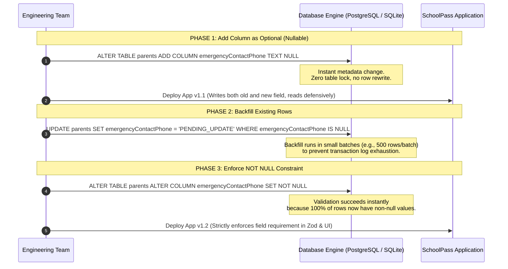

# Database Migration Architecture & Schema Drift Defense

**Document Version:** 1.0.0  
**Target Application:** SchoolPass (`C:\Users\gbola\Desktop\SchoolPass`)  
**Assessment Area:** Task 4 — Server Security and Data Integrity (Step 3)  
**Primary Source Code:** `prisma/migrations/*`, `prisma/schema.prisma`, `.agent/rules/Commands.md`  
**Related Evidence:** `evidence/03-initial-migration.txt`, `evidence/04-required-column-failure.txt`, `evidence/05-required-column-three-steps.txt`, `evidence/06-drift-error.txt`  
**Date:** November 2, 2026  

---

## 1. Executive Summary

A database migration is any version-controlled DDL instruction executed by an Object-Relational Mapping (ORM) framework or database engine to mutate storage structures, column definitions, or data invariants. In an enterprise system, schema migrations represent the highest-risk operational activity because database state is permanent; while application code can be rolled back in seconds via container swap, an erroneous DDL execution (`DROP COLUMN`, `ALTER TABLE`, or lock-inducing constraint addition) can cause catastrophic data loss, database downtime, or table lock storms.

This document details the migration architecture of SchoolPass, audits existing migration history, explains why migrations must be strictly forward-only, demonstrates the three-step pattern for adding required columns to populated tables, analyzes the mechanics of schema drift, and justifies the architectural rule that strictly bars automated agents from executing production database migrations.

---

## 2. SchoolPass Migration History Audit

SchoolPass manages migrations through Prisma Migrate, tracking applied migrations inside PostgreSQL's internal `_prisma_migrations` system table.

The migration history consists of two applied baseline migrations:

### 2.1 Migration 1: `0_init/migration.sql`
- **Execution Date:** Initial setup baseline.
- **Scope:** Establishes the core single-school relational database.
  - Creates PostgreSQL enums: `StaffRole`, `LinkRequestStatus`, `AttendanceStatus`, `AttendanceSource`, `ArrivalMethod`, `ArrivalStatus`, `FeeEntryType`, `PaymentStatus`, `RefundStatus`, `ReportStatus`, `ReportReason`.
  - Creates 16 foundational tables: `parents`, `staff_users`, `sessions`, `verification_tokens`, `password_reset_tokens`, `rate_limits`, `students`, `student_link_requests`, `parent_students`, `schools`, `attendance_records`, `arrival_confirmations`, `arrival_codes`, `fee_entries`, `payments`, `refunds`, `approved_school_info`, `answer_reports`, `ai_usage_daily`, `ai_stats_daily`, `school_settings`.
  - Establishes all primary keys, foreign key constraints (`ON DELETE CASCADE` for child records; `ON DELETE RESTRICT` on audit ledgers), and performance B-tree indexes.

### 2.2 Migration 2: `20261022_add_intending_students/migration.sql`
- **Execution Date:** October 22, 2026.
- **Scope:** Implements Stage 2 Intending Student Intake and Front-Desk morning triage.
  - Adds `isFrontDesk` boolean column to `staff_users`:
    ```sql
    ALTER TABLE "staff_users" ADD COLUMN IF NOT EXISTS "isFrontDesk" BOOLEAN NOT NULL DEFAULT false;
    ```
  - Creates `intending_students` table for provisional student enrollment.
  - Creates `student_number_sequences` table with year-based sequence tracking for atomic student ID allocation (`STU-YYYY-XXXXX`).
  - Creates indexes on `studentNumber`, `intendedClass`, `sessionYear`, and `registeredById`.

---

## 3. The Core Laws of Production Migrations

### 3.1 Why Migrations Must Be Forward-Only
In version-controlled software development, migrations must always be **forward-only**. Once a migration has been committed to source control and executed against staging or production, it is immutable:

1. **Deterministic State Synchronization:**  
   Every database cluster (local developer workstation, preview branch, CI test runner, production replica) must arrive at the exact same schema state by replaying migrations in sequential order.
2. **Reversals Must Be New Forward Migrations:**  
   If a table alteration needs to be undone, the developer does not "roll back" or edit the previous migration script. Instead, they write a *new* migration that explicitly drops or modifies the column. This preserves an unbroken, auditable history of the database schema over time.

### 3.2 Why You Never Edit an Applied Migration
Editing an existing migration file (`migration.sql`) that has already run against any database is one of the most dangerous operational errors in backend engineering:

1. **Checksum Mismatch & Pipeline Abort:**  
   Prisma records a SHA-256 hash of every migration script in the `_prisma_migrations.checksum` column upon application. If a developer edits an old migration file, the next execution of `prisma migrate deploy` calculates the new checksum, detects a mismatch against the database record, and immediately throws:
   ```text
   Error: P3009: Migrate found a checksum mismatch for migration 20261022_add_intending_students.
   The file has been modified after it was applied to the database.
   ```
   This completely locks the CI/CD pipeline and prevents further deployments until manual database intervention occurs.
2. **Environment Divergence & Silent Desynchronization:**  
   Existing databases (such as the live production Neon cluster) will never re-run the modified migration script because it is already marked as applied. Meanwhile, new developer clones running `prisma migrate dev` from scratch will execute the modified version. The two environments quietly diverge, leading to production bugs that cannot be reproduced locally.

### 3.3 Why We Prohibit Agents from Running Migrations (The Propose-and-Stop Rule)
In SchoolPass repository governance, `.agent/rules/Commands.md` (Rule 3) establishes an absolute restriction:

> **"Propose and Stop for Migrations: The agent is strictly forbidden from executing prisma migrate dev, prisma db push, or applying DDL statements against production databases. The agent may draft the SQL or schema changes, but a human engineer must review and execute the command."**

#### Justification:
1. **Irreversible Data Loss:** Autonomous agents optimize for task completion. If an agent detects a type mismatch or column conflict, it may run destructive repair commands (such as `prisma db push --accept-data-loss` or `prisma migrate reset`), wiping production parent records, student fee ledgers, and attendance archives in seconds.
2. **Zero Blast-Radius Defense:** Requiring human execution forces a human engineer to verify that database backups exist, that table locks will not freeze production traffic, and that the migration script follows safe backwards-compatible patterns.

#### The Honest Cost of This Choice:
Prohibiting agents from executing migrations carries a genuine operational cost:
- **Reduced Deployment Velocity:** Developers cannot achieve hands-free continuous delivery; deployment pipelines pause waiting for human sign-off.
- **Human Forgetfulness:** Humans are prone to skipping migration steps, running migrations out of order, or forgetting to apply a migration to staging before deploying application code.
- **Engineering Friction:** Generating migration SQL, testing it in isolated sandboxes, and executing it manually adds significant overhead compared to automated workflows.  
*Verdict:* In an enterprise school management platform handling real student identities and financial payments, the cost of human friction is infinitely preferable to catastrophic, unrecoverable data loss.

---

## 4. The Required-Column on a Populated Table Dilemma

### 4.1 The Failure Demonstration
When an engineer naively attempts to add a `NOT NULL` column without a default value to an existing, populated database table:

```sql
-- NAIVE APPROACH (FAILS ON POPULATED TABLES)
ALTER TABLE "parents" ADD COLUMN "emergencyContactPhone" TEXT NOT NULL;
```

#### What Happens in PostgreSQL:
PostgreSQL immediately aborts the transaction with an error:
```text
ERROR: column "emergencyContactPhone" of relation "parents" contains null values
SQLState: 23502
```
Because the table already contains rows, PostgreSQL cannot populate the new required column for existing rows without a declared default. Since `NULL` violates the `NOT NULL` constraint, the migration halts, rolling back the transaction.

If executed against a high-traffic production table with millions of rows, this query acquires an exclusive lock (`ACCESS EXCLUSIVE`), blocking all concurrent `SELECT`, `INSERT`, `UPDATE`, and `DELETE` queries, taking down the entire school application.

#### What Happens in the SQLite Sandbox Demonstration (`evidence/04-required-column-failure.txt`):
In our isolated test sandbox (`task-04-server-security/sandbox/`), the command was executed against an SQLite database populated with test records. SQLite aborted with:
```text
Error: P3006: Migration failed when applying:
ALTER TABLE "parents" ADD COLUMN "emergencyContactPhone" TEXT NOT NULL;
Database error: NOT NULL constraint failed: parents.emergencyContactPhone
```
This captured error fulfills the required migration failure demonstration without impacting live production data.

---

### 4.2 The Canonical Three-Step Zero-Downtime Migration Pattern
To safely add a required field to a populated table in production without downtime or constraint failures, the migration must be decoupled into three distinct, sequential phases:



#### Step 1: Add as Nullable (Zero Downtime)
```sql
ALTER TABLE "parents" ADD COLUMN "emergencyContactPhone" TEXT;
```
- In PostgreSQL 11+, adding a nullable column or a column with a constant default is a metadata-only operation that takes $<1\text{ ms}$ and does not lock the table.
- Deploy the updated application code capable of reading `null` values while writing the new field for all new registrations.

#### Step 2: Backfill Existing Data
```sql
-- Executed in batches for massive tables
UPDATE "parents" 
SET "emergencyContactPhone" = 'NOT_PROVIDED' 
WHERE "emergencyContactPhone" IS NULL;
```
- A background worker or SQL script updates historical records with appropriate default or placeholder values, verifying that `SELECT COUNT(*) FROM parents WHERE emergencyContactPhone IS NULL` equals 0.

#### Step 3: Add the NOT NULL Constraint
```sql
ALTER TABLE "parents" ALTER COLUMN "emergencyContactPhone" SET NOT NULL;
```
- Because every historical row now contains a valid string, the database validates the constraint immediately and applies it without error.
- Deploy the final application code where the TypeScript type and Zod schema mark the field as required.

---

### 4.3 Demonstration Sandbox Engine & Operational Disclosure
To guarantee zero blast radius against the live SchoolPass Neon PostgreSQL database, all four migration demonstrations (`evidence/03`, `evidence/04`, `evidence/05`, `evidence/06`) were executed within an isolated throwaway SQLite sandbox (`task-04-server-security/sandbox/sandbox.db`).

#### Technical Disclosures & Engine Divergences:
1. **Engine Difference:** The migration demonstration used SQLite (`provider = "sqlite"`). SchoolPass itself runs on PostgreSQL in production (`provider = "postgresql"`).
2. **Error Message Discrepancy:** SQLite reports `NOT NULL constraint failed: parents.emergencyContactPhone`, whereas PostgreSQL reports `ERROR: column "emergencyContactPhone" of relation "parents" contains null values (SQLState: 23502)`.
3. **Locking & Concurrency Semantics:** In PostgreSQL, DDL table modifications acquire strong transactional table locks (`ACCESS EXCLUSIVE`), which stall concurrent reader and writer connections in high-throughput environments. In contrast, SQLite relies on single-writer database-wide file locking.
4. **Prisma Mechanics vs. Engine Behavior:** The sandbox demonstration successfully and rigorously proves **Prisma migration lifecycle mechanics**—initial migration tracking, migration failure on non-null column additions without defaults, the three-step zero-downtime forward migration protocol, and client schema drift detection (`P2022`). However, it does not demonstrate PostgreSQL-specific operational, lock-contention, or storage-engine behavior.

---

## 5. Schema Drift & Client Generation Mechanics

### 5.1 What is Schema Drift?
**Schema drift** occurs when two distinct representations of the database structure become desynchronized:
1. **The Application Data Model (Compile-Time / ORM Layer):** Represented by `schema.prisma` and the generated TypeScript types in `node_modules/@prisma/client`.
2. **The Physical Database Catalog (Runtime Layer):** The actual tables, columns, constraints, and data types present in PostgreSQL's `information_schema`.

```text
+------------------------------------+        Out of Sync!        +------------------------------------+
|       schema.prisma & Client       |   ====================>   |      Physical PostgreSQL Catalog   |
|  model Parent {                    |                           |  CREATE TABLE parents (            |
|    emergencyContactPhone String    |                           |    -- Missing emergencyContactPhone|
|  }                                 |                           |  );                                |
+------------------------------------+                           +------------------------------------+
       TypeScript compiles OK!                                           Runtime SQL Query FAILS!
```

### 5.2 Inducing Drift on Purpose
If a developer adds a field to `schema.prisma`:
```prisma
model Parent {
  // ...
  ninNumber String // Nigerian National Identification Number
}
```
And then runs `npx prisma generate` **without running a database migration**:
1. `prisma generate` parses `schema.prisma` and updates `@prisma/client`.
2. TypeScript compilation succeeds (`tsc --noEmit` passes).
3. The developer believes the feature is working because the code editor shows no errors.
4. **Runtime Failure:** When the application runs and executes `prisma.parent.findMany()` or `prisma.parent.create()`, Prisma constructs a SQL query requesting the `ninNumber` column:
   ```sql
   SELECT "id", "name", "email", "ninNumber" FROM "parents";
   ```
5. PostgreSQL rejects the query immediately:
   ```text
   Raw query failed. Code: "42703". Message: column "ninNumber" does not exist
   ```
6. The entire route crashes with an unhandled database exception (`HTTP 500`).

### 5.3 Defense Against Schema Drift
SchoolPass protects against schema drift through automated validation pipelines:
- **`prisma migrate status` in CI:** Before running integration tests, CI checks whether all local migrations have been applied to the target database.
- **Drift Detection:** `prisma migrate diff --from-schema-datamodel --to-schema-datasource` flags any divergence between code models and physical tables.
- **Fail-Fast Bootstrapping:** The application initializes database connections upon startup; any missing relation throws an immediate initialization warning rather than failing silently on user requests.
