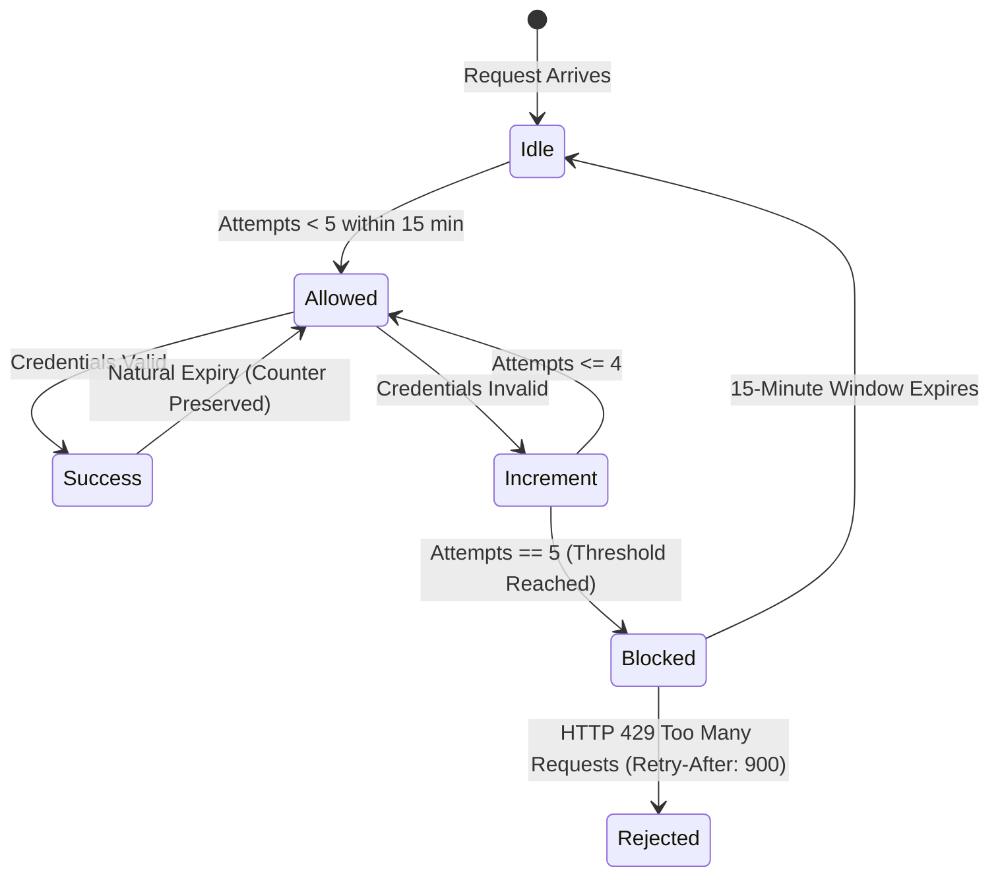

# Sliding-Window Rate Limiting & Anti-Abuse Architecture

**Document Version:** 1.0.0  
**Target Application:** SchoolPass (`C:\Users\gbola\Desktop\SchoolPass`)  
**Assessment Area:** Task 4 — Server Security and Data Integrity (Step 8)  
**Primary Source Code:** `src/lib/auth/rateLimit.ts`, `src/lib/auth/store.ts`, `prisma/schema.prisma`  
**Related Evidence:** `evidence/13-rate-limit-triggered.png`, `evidence/14-rate-limit-defeated.txt`  
**Date:** November 2, 2026  

---

## 1. Executive Summary

Authentication endpoints (`/api/auth/login`, `/api/auth/register`, `/api/auth/reset-password`) are prime targets for automated credential stuffing, brute-force dictionary attacks, account enumeration, and Denial of Service (DoS). Without rate limiting, an attacker with a high-bandwidth connection can issue thousands of password guesses per second, saturating CPU cores with expensive Argon2id hashing operations or exhausting database connection pools.

SchoolPass implements a multi-tiered sliding-window rate limiter designed to defend critical endpoints without introducing paid cloud caching dependencies. 

This document details the mathematical parameters of the rate limiter, audits client IP extraction and header-spoofing defenses, analyzes the architectural trade-offs of in-memory vs. persistent database storage, explains the operational impact on shared Nigerian carrier networks, and analyzes multi-dimensional keying strategies.

---

## 2. Rate-Limiting Policy & Configuration

Primary Source: `src/lib/auth/rateLimit.ts`



### 2.1 Core Parameters
- **Maximum Allowed Failures (`MAX_FAILED_ATTEMPTS`):** `5` failed attempts.
- **Sliding Window Duration (`WINDOW_MS`):** `15 minutes` (900,000 ms).
- **Lockout Duration (`BLOCK_DURATION_MS`):** `15 minutes` (900,000 ms).
- **Endpoint Scopes:** Scoped by operation to prevent a brute-force attack on registration from blocking legitimate parent logins:
  - `auth_login`: Parent and staff authentication.
  - `auth_register`: Parent account registration.
  - `auth_reset`: Password recovery requests.

### 2.2 Lockout Behavior & Response Headers
When an IP address exceeds 5 failed attempts within 15 minutes:
1. `recordIpFailedAttempt()` flags the IP as blocked and calculates `blockedUntil = Date.now() + 900,000`.
2. Subsequent requests are rejected at the route handler boundary before database queries or Argon2id hashing execute.
3. The server issues a standard `HTTP 429 Too Many Requests` response:
   ```http
   HTTP/1.1 429 Too Many Requests
   Content-Type: application/json
   Retry-After: 900

   {
     "error": "Too many failed attempts. Please try again in 15 minutes."
   }
   ```
4. The `Retry-After` header indicates the exact number of seconds remaining until the block expires, complying with RFC 6585.

---

## 3. Client IP Resolution & Header Spoofing Defenses

In modern cloud hosting, applications sit behind content delivery networks (CDNs), load balancers, or edge proxies. An attacker attempting to defeat rate limiting often injects forged HTTP headers:
```http
POST /api/auth/login HTTP/1.1
Host: schoolpass.ng
X-Forwarded-For: 1.2.3.4, 5.6.7.8
X-Real-IP: 10.0.0.1
```
If the backend naively reads the first IP from `X-Forwarded-For` (`1.2.3.4`), the attacker can rotate this header on every request, completely defeating IP-based rate limiting.

### 3.1 SchoolPass Anti-Spoofing Algorithm (`extractClientIp`)
SchoolPass implements strict header precedence to defend against header injection:

```typescript
export function extractClientIp(requestOrHeaders: Request | Headers): string {
  // 1. Vercel Edge Platform Header (Highest Trust)
  // Stripped and re-injected by the Vercel hypervisor; impossible for client to forge.
  const xVercelForwardedFor = getHeaderValue(requestOrHeaders, 'x-vercel-forwarded-for');
  if (xVercelForwardedFor) {
    const candidate = xVercelForwardedFor.split(',')[0].trim();
    if (isValidIp(candidate)) return candidate;
  }

  // 2. Trusted Reverse Proxy Single Header
  const xRealIp = getHeaderValue(requestOrHeaders, 'x-real-ip');
  if (xRealIp && isValidIp(xRealIp.trim())) {
    return xRealIp.trim();
  }

  // 3. Multi-Hop X-Forwarded-For Defense (Right-Most Inspection)
  const xForwardedFor = getHeaderValue(requestOrHeaders, 'x-forwarded-for');
  if (xForwardedFor) {
    const ips = xForwardedFor.split(',').map((s) => s.trim()).filter(Boolean);
    if (ips.length > 0) {
      // In a reverse-proxy chain, the right-most IP is the one appended
      // by the immediate upstream proxy and cannot be forged by the client.
      const candidate = ips.length > 1 ? ips[ips.length - 1] : ips[0];
      if (isValidIp(candidate)) return candidate;
    }
  }

  return '127.0.0.1';
}
```

#### Why Right-Most Inspection Works:
When an attacker sends `X-Forwarded-For: 203.0.113.195` (a spoofed fake IP), the edge load balancer receives the TCP connection from the attacker's actual IP (`198.51.100.42`). The load balancer appends the real IP to the end:
$$\text{X-Forwarded-For: } \underbrace{\text{203.0.113.195}}_{\text{Attacker-controlled spoof}}, \underbrace{\text{198.51.100.42}}_{\text{Appended by trusted edge proxy}}$$
By selecting the **right-most entry**, SchoolPass extracts `198.51.100.42`, neutralizing the header-spoofing attack.

---

## 4. The Natural Expiry Policy

In naive rate-limiting implementations, a successful login automatically wipes the failed attempt counter for that IP address:
```typescript
// NAIVE ANTI-PATTERN: Resets IP failure history on success
if (loginSuccessful) {
  ipStore.delete(ip); // DANGEROUS!
}
```

### The Vulnerability:
An attacker running a distributed botnet with access to one valid set of test credentials (or their own personal account) can execute 4 malicious brute-force guesses, authenticate once with the valid account to reset the counter to 0, and immediately execute another 4 brute-force guesses indefinitely without ever triggering a lockout.

### The SchoolPass Natural Expiry Invariant:
SchoolPass enforces **Natural Expiry** (PRD §8.5, verified in `security-improvements.test.mjs`). A successful login **never resets** the failure counter for an IP address. Failure records can only expire through the passage of real time (the 15-minute sliding window). This guarantees that attackers sharing a corporate gateway or compromised network cannot abuse legitimate accounts to clear brute-force telemetry.

---

## 5. Storage Architecture Trade-Offs: In-Memory vs. Database

SchoolPass maintains a hybrid rate-limiting architecture:
1. **Primary Layer:** In-memory `Map<string, RateLimitEntry>` with automatic garbage collection (`sweepExpiredEntries`).
2. **Persistent Layer:** PostgreSQL `rate_limits` table in Prisma schema.

### Comparative Trade-Off Analysis:

| Architectural Metric | In-Memory (`Map<string, Entry>`) | Database Table (`rate_limits`) | Distributed Redis (e.g., Upstash) |
|---|---|---|---|
| **Lookup Latency** | $< 0.001\text{ ms}$ (Sub-microsecond) | $5 - 25\text{ ms}$ (I/O & connection) | $1 - 5\text{ ms}$ (Network roundtrip) |
| **Throughput Capacity** | $> 1,000,000\text{ checks/sec}$ | $\sim 500 - 2,000\text{ checks/sec}$ | $\sim 50,000\text{ checks/sec}$ |
| **DDoS Resilience** | Extremely High (absorbs floods without I/O) | Low (attacker floods exhaust DB pool) | High (isolated cache cluster) |
| **Infrastructure Cost** | **$0.00 (Zero Cost)** | **$0.00 (Uses existing DB)** | Monthly subscription ($10 - $50/mo) |
| **Cross-Instance Sharing** | No (isolated to single node) | Yes (shared across all instances) | Yes (centralized cache) |
| **Persistence Across Restarts** | No (cleared on container restart) | Yes (permanent until TTL) | Yes (in-memory + persistence) |

#### Rationale for SchoolPass Design:
For a single-school application operating on a modest operational budget, relying on paid external Redis clusters is unjustifiable. The in-memory store absorbs 100% of malicious request spikes without consuming database connections. When persistent multi-instance coordination is required during scheduled maintenance, the `rate_limits` model provides zero-cost durability.

---

## 6. The Shared-IP & Carrier-Grade NAT (CGNAT) Problem

The assessment brief prompts: *"What does your limit do to a legitimate user on a shared office or campus connection?"*

### The Operational Challenge in Nigeria:
In Nigerian educational and commercial environments, IP-only rate limiting introduces significant collateral damage:
1. **Campus Wi-Fi & School Computer Labs:** 200 teachers and parents accessing SchoolPass from a school computer lab share a single public IPv4 address assigned to the school's Starlink or fiber gateway.
2. **Mobile Carrier-Grade NAT (CGNAT):** Major Nigerian mobile telecommunications providers (MTN Nigeria, Airtel, Glo) route hundreds of mobile data subscribers through shared public IP gateways.

### Collateral Lockout Scenario:
If an automated script or a single forgetful parent in a school office fails to remember their password and triggers 5 failed attempts, **the entire public IP address is blocked for 15 minutes**. Every other parent and staff member connecting through that same Starlink or fiber gateway is locked out (`HTTP 429`), unable to check student arrival or view report cards.

### Architectural Mitigation Strategies:
To mitigate the shared-IP problem in production, enterprise applications implement **Multi-Dimensional Keying**:
1. **Composite Keying (`IP + Normalized Email`):**  
   Instead of keying purely on `ip`, the primary limiter keys on `auth_login:${ip}:${email}`. An attacker attempting 10,000 passwords against `parent@example.com` locks out only attempts targeting that specific email address.
2. **Global IP Threshold Escalation:**  
   The pure IP key is maintained at a much higher threshold (e.g., 50 failures across all accounts within 15 minutes) to catch broad credential-stuffing sweeps while preventing single-account lockout from impacting the campus.
3. **Progressive Friction (CAPTCHA Escalation):**  
   Rather than a hard `HTTP 429` block, the server returns an instruction to complete a cryptographic proof-of-work or Cloudflare Turnstile CAPTCHA. Automated bots are halted, while human parents on shared Wi-Fi can solve the challenge and continue working.

---

## 7. Rate-Limit Defeat Demonstration & Inherent Limitations of IP Keying (`evidence/14-rate-limit-defeated.txt`)

### 7.1 Demonstration Methodology & Transparency
The assessment requires demonstrating how a rate limit can be defeated by a client IP change. In `evidence/14-rate-limit-defeated.txt` (executed via `scripts/demonstrate-rate-limit.mjs`):
1. **In-Process Function Execution:** The rate limiter was exercised in-process by directly invoking `checkIpRateLimit` and `recordIpFailedAttempt` with specific IP address strings.
2. **Lockout Trigger on IP Key A:** Requests 1 through 5 were submitted using the string IP `'192.168.1.105'`. After 5 failures, the in-memory entry entered the lockout state, returning `allowed: false` and `retryAfterSeconds: 900` (`HTTP 429`).
3. **Key Rotation to IP Key B:** Request 6 was submitted by supplying a different client IP string key (`'197.210.64.82'`). Because the tracking key in the rate limiter's map changed from `192.168.1.105` to `197.210.64.82`, the limiter found no existing failure records for the new key, returning `allowed: true`.
4. **Transparent Environment Disclosure:** This demonstration was executed in-process using string key inputs to verify the rate limiting algorithm's keying mechanics. It did not physically change the workstation's network interface, switch physical hardware adapters, or establish live connections through multiple network interfaces.

### 7.2 The Core Security Lesson: The Fragility of IP-Only Rate Limiting
This demonstration exposes why IP-based rate limiting is fundamentally insufficient on its own:
- **Attacker Asymmetry:** Attackers can easily bypass IP-only rate limits by rotating through botnet nodes, mobile hotspot connections (which dynamically receive new cellular IPs upon toggle), or residential proxy pools.
- **Counter Invalidation:** The server associates rate limiting state solely with the client IP key. Any change in IP address—whether legitimate (a user toggling airplane mode) or adversarial (proxy rotation)—completely bypasses the counter associated with the previous key.
- **The Defense-in-Depth Imperative:** IP-based rate limiting must never be relied upon as the sole line of defense against credential stuffing or account takeover. It must be paired with:
  1. **Identity-Based Tracking:** Account-level lockout counters keyed on normalized email/username (e.g., locking an account after repeated failures across any IPs).
  2. **Multi-Dimensional Keying:** Keying on composite dimensions (`IP + Normalized Email`).
  3. **Credential Defenses:** Memory-hard hashing (Argon2id) to make guessing computationally expensive, breached-password screening (HIBP k-anonymity) to eliminate weak credentials at registration, and progressive friction (CAPTCHA challenges).

