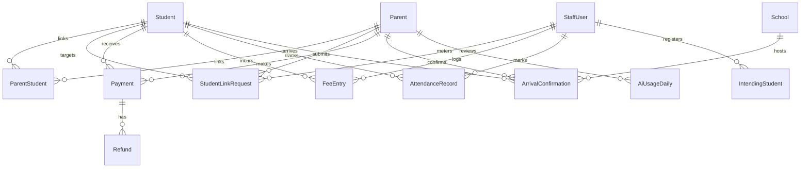

# SchoolPass Database Schema & Data Integrity Architecture

**Document Version:** 1.0.0  
**Target Application:** SchoolPass (`C:\Users\gbola\Desktop\SchoolPass`)  
**Assessment Area:** Task 4 — Server Security and Data Integrity (Step 1)  
**Primary Source Code:** `prisma/schema.prisma`  
**Related Evidence:** `evidence/01-schema-drawing.jpg`, `evidence/02-database-state-before.png`  
**Date:** November 2, 2026  

---

## 1. Executive Summary

SchoolPass operates on a single-school architecture designed for Nigerian primary and secondary schools. The database engine is PostgreSQL (hosted on Neon Serverless PostgreSQL), accessed via Prisma ORM with connection pooling for standard transactions and unpooled direct connections for administrative migrations.

In accordance with the SchoolPass PRD v6.0 and Addendum v6.1, the schema enforces strict entity isolation, role separation, cryptographic hash storage, double-entry financial tracking, and transparent parent-student linking.

This document provides a comprehensive technical audit of the active Prisma schema, maps all entity relationships and indexes, answers the statutory 14-month financial inquiry question, and presents the formal planning-level specifications for the two schema models identified in the assessment brief: `PaymentAttempt` and `RetrievalChunk`.

---

## 2. Active Schema Entity Audit

The production schema contains 18 models organized into 8 functional domains:



### 2.1 Identity, Authentication & Sessions Domain

#### Model: `Parent` (`parents`)
Primary identity table for student guardians and parents.
- `id` (`String` / `cuid()`): Primary key.
- `name` (`String`): Full parent name (minimum two words, enforced by boundary validation).
- `email` (`String` / `unique`): Unique normalized lowercase email address.
- `passwordHash` (`String`): Current Argon2id PHC hash string ($m=65536, t=3, p=1$).
- `previousPasswordHashes` (`String[]` / `@default([])`): Array of previous password hashes to prevent reusing the last 3 passwords (PRD §8.2, §17).
- `emailVerifiedAt` (`DateTime?` / nullable): Timestamp of cryptographic email-link verification. Null indicates unverified state.
- `createdAt` (`DateTime` / `@default(now())`): Account creation audit timestamp.
- `updatedAt` (`DateTime` / `@updatedAt`): Automatic row update timestamp.
- **Indexes:** Implicit unique B-tree index on `email`.

#### Model: `StaffUser` (`staff_users`)
Identity table for teaching, administrative, and front-desk personnel.
- `id` (`String` / `cuid()`): Primary key.
- `name` (`String`): Full staff member name.
- `email` (`String` / `unique`): Unique staff email address.
- `passwordHash` (`String`): Modern Argon2id PHC hash string.
- `role` (`StaffRole` enum: `STAFF`, `ADMIN`): System permission role.
- `isFrontDesk` (`Boolean` / `@default(false)`): Quick-access flag for front-desk morning arrival verification.
- `createdAt` / `updatedAt`: Standard audit timestamps.
- **Indexes:** Implicit unique index on `email`.

#### Model: `Session` (`sessions`)
Server-side session store supporting cookie-based session tokens.
- `id` (`String` / `cuid()`): Session ID stored inside the signed HTTP-only session cookie.
- `userId` (`String`): Foreign identifier referencing `Parent.id` or `StaffUser.id`.
- `role` (`String`): `"parent"` | `"staff"` | `"admin"`.
- `expiresAt` (`DateTime`): Absolute session expiration timestamp.
- `createdAt` (`DateTime`): Session issue timestamp.
- **Index:** `@@index([userId])` — Accelerates user session lookup and revocation during logout or password reset. Write cost: 1 additional B-tree node write per session issue.

#### Model: `VerificationToken` (`verification_tokens`)
Cryptographic token store for parent email address verification.
- `id` (`String` / `cuid()`): Primary key.
- `email` (`String`): Target parent email address.
- `tokenHash` (`String` / `unique`): SHA-256 hash of the 32-byte cryptographic token transmitted via email.
- `expiresAt` (`DateTime`): 24-hour expiration timestamp.
- `createdAt` (`DateTime`): Token generation timestamp.
- **Index:** `@@index([email])` — Accelerates lookup during verification resend requests.

#### Model: `PasswordResetToken` (`password_reset_tokens`)
Cryptographic token store for self-service password recovery.
- `id` (`String` / `cuid()`): Primary key.
- `email` (`String`): Target user email address.
- `tokenHash` (`String` / `unique`): SHA-256 hash of the 32-byte password reset token.
- `expiresAt` (`DateTime`): 1-hour expiration timestamp.
- `createdAt` (`DateTime`): Generation timestamp.
- **Index:** `@@index([email])`.

#### Model: `RateLimit` (`rate_limits`)
Persistent rate limit storage for tracking failed authentication attempts across server restarts.
- `key` (`String` / `@id`): Composite identifier (`scope:ip` or `scope:account`).
- `attempts` (`Int` / `@default(0)`): Counter of failed attempts within the sliding window.
- `blockedUntil` (`DateTime?`): Active lockout timestamp.
- `updatedAt` (`DateTime` / `@updatedAt`): Timestamp of the last failed attempt.

---

### 2.2 Students & Guardian Linking Domain

#### Model: `Student` (`students`)
Enrolled student record.
- `id` (`String` / `cuid()`): Primary key.
- `studentNumber` (`String` / `unique`): Human-readable matriculation number (`STU-XXXXX`).
- `name` (`String`): Full student legal name.
- `className` (`String`): Academic grade/class (e.g., `"JSS 2A"`).
- `isActive` (`Boolean` / `@default(true)`): Active enrollment status.
- `createdAt` / `updatedAt`: Standard audit timestamps.
- **Index:** Unique index on `studentNumber`.

#### Model: `ParentStudent` (`parent_students`)
Many-to-many join table establishing verified guardian-student relationships.
- `id` (`String` / `cuid()`): Primary key.
- `parentId` (`String` / FK): References `Parent.id` (`onDelete: Cascade`).
- `studentId` (`String` / FK): References `Student.id` (`onDelete: Cascade`).
- `createdAt` (`DateTime`): Link establishment timestamp.
- **Constraints & Indexes:**
  - `@@unique([parentId, studentId])` — Prevents duplicate active guardian links.
  - `@@index([studentId])` — Accelerates querying all parents associated with a given student.

#### Model: `StudentLinkRequest` (`student_link_requests`)
Audit workflow table for pending, approved, or rejected parent-student linkage requests.
- `id` (`String` / `cuid()`): Primary key.
- `parentId` (`String` / FK): References `Parent.id`.
- `studentId` (`String` / FK): References `Student.id`.
- `status` (`LinkRequestStatus` enum: `PENDING`, `APPROVED`, `REJECTED`): Workflow status.
- `rejectionReason` (`String?`): Optional explanation recorded by reviewing staff.
- `reviewedByStaffId` (`String?` / FK): References `StaffUser.id` (`onDelete: SetNull`).
- `createdAt` / `updatedAt`: Standard audit timestamps.
- **Indexes:** `@@index([parentId])`, `@@index([studentId])`, `@@index([status])`.

---

### 2.3 Financial & Accounting Domain

#### Model: `FeeEntry` (`fee_entries`)
Debit and credit entries tracking student fee obligations.
- `id` (`String` / `cuid()`): Primary key.
- `studentId` (`String` / FK): References `Student.id`.
- `termId` (`String`): Academic term identifier (e.g., `"2025-2026-T1"`).
- `type` (`FeeEntryType` enum: `CHARGE`, `ADJUSTMENT`, `OFFLINE_PAYMENT`): Ledger transaction type.
- `amount` (`Decimal` / `@db.Decimal(12, 2)`): Monetary value in Nigerian Naira (NGN) with fixed 2-decimal precision.
- `note` (`String?`): Human-readable ledger annotation.
- `createdByStaffId` (`String` / FK): References `StaffUser.id` (`onDelete: Restrict` — preserves audit trail).
- `createdAt` (`DateTime`): Entry timestamp.
- **Indexes:**
  - `@@index([studentId, termId])` — Composite index for calculating term fee balances.
  - `@@index([createdByStaffId])` — Audit trail index for reviewing staff entries.

#### Model: `Payment` (`payments`)
Completed or verified parent payments processed via payment gateway (Flutterwave).
- `id` (`String` / `cuid()`): Primary key.
- `studentId` (`String` / FK): References `Student.id`.
- `parentId` (`String` / FK): References `Parent.id`.
- `amount` (`Decimal` / `@db.Decimal(12, 2)`): Transaction amount in NGN.
- `internalReference` (`String` / `unique`): Unique internal merchant transaction reference (`SCH-PAY-XXXXX`).
- `flutterwaveReference` (`String?` / `unique`): External gateway reference ID.
- `status` (`PaymentStatus` enum: `PENDING`, `SUCCESSFUL`, `FAILED`, `REFUNDED`).
- `createdAt` (`DateTime`): Payment initiation timestamp.
- `verifiedAt` (`DateTime?`): Webhook verification confirmation timestamp.
- **Indexes:** `@@index([studentId])`, `@@index([parentId])`, `@@index([status])`.

#### Model: `Refund` (`refunds`)
Financial refund transactions associated with confirmed payments.
- `id` (`String` / `cuid()`): Primary key.
- `paymentId` (`String` / FK): References `Payment.id`.
- `amount` (`Decimal` / `@db.Decimal(12, 2)`): Refunded amount.
- `status` (`RefundStatus` enum: `PENDING`, `CONFIRMED`).
- `createdAt` (`DateTime`): Refund issuance timestamp.
- **Index:** `@@index([paymentId])`.

---

### 2.4 Controlled Denormalization & Duplicate Storage

The assessment brief prompts: *"Where the same fact is stored twice, if anywhere, and why you accepted that."*

In the SchoolPass schema, intentional denormalization occurs in two specific locations:

1. **`ArrivalConfirmation.date` and `ArrivalConfirmation.time`:**
   - Both are stored as `DateTime` fields. In PostgreSQL, `time` contains the full ISO timestamp including date.
   - **Reason for Acceptance:** PostgreSQL composite uniqueness constraint `@@unique([studentId, date])` enforces the critical business invariant that a student can only have **one arrival confirmation per calendar day**. Storing `date` truncated to midnight allows a simple B-tree unique index without resorting to complex functional expression indexes (`DATE(time)`), which Prisma does not natively manage across multi-database environments.
2. **`Student.studentNumber` vs `Student.id`:**
   - Both are unique string identifiers. `id` is an internal opaque CUID; `studentNumber` is a human-readable identifier (`STU-12345`).
   - **Reason for Acceptance:** CUIDs guarantee zero-collision primary keys across distributed systems and avoid exposing auto-incrementing serial integers to clients. Human-readable student numbers are required by parents and staff on physical student ID cards and bank deposit slips.

---

## 3. Statutory Financial Compliance: The 14-Month Tax Inquiry

### Question:
*What would you do if your tax authority (e.g., FIRS / State Internal Revenue Service) asked you to account for a specific transaction from fourteen months ago?*

### Formal Response:
If the Federal Inland Revenue Service (FIRS) or State Board of Internal Revenue requested reconciliation for a specific school fee transaction executed 14 months ago:

1. **Query Immutable Primary Ledgers:**
   I would query the `payments` table using the provided `internalReference` or `flutterwaveReference`. Because the `payments` table has an explicit composite audit structure (`id`, `studentId`, `parentId`, `amount`, `status`, `createdAt`, `verifiedAt`), the record provides proof of the exact timestamp when funds were settled.
2. **Reconcile Against Associated Entities:**
   Using the foreign keys, I would retrieve the `Parent` record (identifying the paying party, name, and registered email), the `Student` record (identifying the beneficiary student, matriculation number, and class at the time), and the associated `fee_entries` row (confirming whether the payment satisfied an academic tuition charge or extracurricular fee).
3. **Cross-Reference External Settlement Logs:**
   The `flutterwaveReference` links directly to the third-party payment gateway transaction settlement manifest. The internal ledger amount is compared against the gateway payout report deposited into the school's commercial bank account.
4. **Inspect Failed or Abandoned Attempts:**
   If the tax inquiry pertains to a disputed charge where the parent claims a duplicate debit, I would consult the proposed `PaymentAttempt` audit table. This would prove whether an earlier transaction was abandoned, rejected for insufficient funds, or failed due to network timeout before the successful payment was logged.
5. **Preservation Invariant:**
   SchoolPass financial records are protected by database foreign-key constraints (`onDelete: Restrict` on `createdByStaffId`). No staff user or administrator can delete a historical fee entry, guaranteeing complete auditability across multi-year statutory retention periods (Nigeria Companies and Allied Matters Act mandates 6-year retention).

---

## 4. Assessment Gap Analysis: Missing Schema Models

The Task 4 assessment brief requires two tables that are currently absent from the production `schema.prisma`:
1. A **money-attempts table** separate from payments.
2. A **retrieval-chunks table** for semantic AI document search.

In accordance with strict assessment boundaries, **these models are NOT added to `schema.prisma` in production**. Doing so would trigger client type drift and risk database desynchronization. Instead, they are formally designed below at a planning level.

### 4.1 Proposed Model: `PaymentAttempt`
Captures all payment attempts initiated by users, including failures, network drops, expired payment sessions, and user cancellations, before a transaction reaches the `Payment` ledger.

```prisma
enum PaymentAttemptStatus {
  INITIATED
  PROCESSING
  ABANDONED
  FAILED_INSUFFICIENT_FUNDS
  FAILED_GATEWAY_REJECTED
  FAILED_TIMEOUT
  COMPLETED
}

model PaymentAttempt {
  id                String               @id @default(cuid())
  parentId          String
  studentId         String
  amount            Decimal              @db.Decimal(12, 2)
  currency          String               @default("NGN")
  gateway           String               @default("FLUTTERWAVE")
  clientIp          String?
  userAgent         String?
  failureReason     String?
  gatewayErrorCode  String?
  idempotencyKey    String               @unique
  status            PaymentAttemptStatus @default(INITIATED)
  initiatedAt       DateTime             @default(now())
  concludedAt       DateTime?

  parent  Parent  @relation(fields: [parentId], references: [id], onDelete: Restrict)
  student Student @relation(fields: [studentId], references: [id], onDelete: Restrict)

  @@index([parentId])
  @@index([studentId])
  @@index([status])
  @@index([initiatedAt])
  @@map("payment_attempts")
}
```

#### Why `PaymentAttempt` Matters:
1. **Drop-Off Conversion Analytics:** Identifies parents who encounter banking network failures or abandon payment at checkout, enabling automated retry alerts.
2. **Litigation & Fraud Defense:** Protects the school against fraudulent chargebacks by logging the client IP, user-agent, and gateway error code for every failed transaction attempt.

---

### 4.2 Proposed Model: `RetrievalChunk`
Stores vectorized knowledge chunks for the SchoolPass AI parent inquiry assistant, enabling semantic similarity search and retrieval-augmented generation (RAG).

```prisma
model RetrievalChunk {
  id             String    @id @default(cuid())
  sourceDocument String    // e.g., "Parent_Handbook_2025_2026.pdf"
  sectionTitle   String    // e.g., "Tuition Deadlines & Installment Policies"
  chunkIndex     Int       // Sequence index within document
  content        String    @db.Text
  tokenCount     Int
  embeddingModel String    @default("text-embedding-3-small")
  embedding      Unsupported("vector(1536)")? // pgvector extension column
  metadata       Json?     // Category, effective term, permission tags
  createdAt      DateTime  @default(now())
  updatedAt      DateTime  @updatedAt

  @@index([sourceDocument])
  @@index([chunkIndex])
  @@map("retrieval_chunks")
}
```

#### Architectural Justification:
- **`Unsupported("vector(1536)")`:** Leverages PostgreSQL's `pgvector` extension for sub-millisecond cosine distance indexing (`HNSW` / `IVFFlat`).
- **`metadata Json?`:** Allows filtering chunks by grade level, academic term, or audience without duplicating chunk rows.
- **Strict Boundary Preservation:** Maintains zero foreign keys to private student or fee data, strictly upholding PRD §8.5 (AI Governance invariant prohibiting student record exposure to LLMs).
