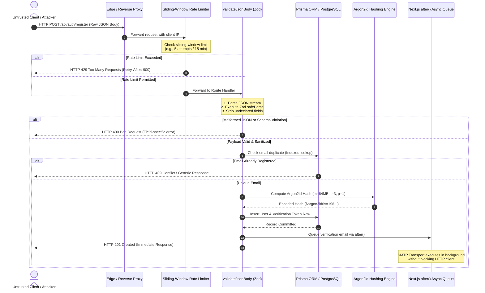

# Server-Side Boundary Validation & Request Lifecycle Placement

**Document Version:** 1.0.0  
**Target Application:** SchoolPass (`C:\Users\gbola\Desktop\SchoolPass`)  
**Assessment Area:** Task 4 — Server Security and Data Integrity (Step 6)  
**Primary Source Code:** `src/lib/auth/validation.ts`, `src/lib/auth/schemas.ts`, `src/app/api/auth/*`  
**Evidence Artifact:** [`evidence/11-validation-timing.txt`](file:///C:/Users/gbola/Desktop/SchoolPass-Assessment/task-04-server-security/evidence/11-validation-timing.txt)  
**Date:** November 2, 2026  

---

## 1. Executive Summary

In a modern client-server architecture, client-side validation is purely a user-experience affordance. Any motivated user, automated bot, or malicious script can bypass client-side JavaScript entirely using `curl`, Postman, or automated testing harnesses to send arbitrary payloads directly to API endpoints. 

Therefore, **the server is the sole source of truth**. Server-side validation is not merely a repetition of frontend rules; it is a critical defensive boundary that protects application state, business invariants, downstream database engines, and cryptographic services from malformed, oversized, or malicious data.

This document details the architectural placement of schema validation within the SchoolPass request lifecycle, defines the strict ordering of pre-validation and post-validation operations, contrasts declarative schema parsing against hand-written route checks, and analyzes empirical local hardware benchmarks measuring the true microsecond cost of Zod validation.

---

## 2. Request Lifecycle Architecture

In SchoolPass, validation is implemented as a strict gateway at the controller boundary. The request lifecycle follows a defense-in-depth model where low-cost, low-trust operations execute first, and expensive, high-trust operations are deferred until payload integrity is guaranteed.



---

## 3. What Runs Before Validation

To protect the server from Denial of Service (DoS) attacks and resource exhaustion, only cheap, stateless, or boundary-protection operations are allowed to execute prior to schema validation:

1. **TLS / Network Termination:**  
   The web server (or upstream reverse proxy) handles transport encryption, terminates TLS handshakes, verifies HTTP protocol syntax, and enforces global HTTP request size limits (e.g., rejecting payloads larger than 1 MB).
2. **HTTP Method & Header Inspection:**  
   Verification that the HTTP method matches the expected verb (e.g., `POST`), and that the `Content-Type` header specifies `application/json`.
3. **Client IP Extraction & Sliding-Window Rate Limiting:**  
   `extractClientIp()` resolves the client address (prioritizing trusted proxy headers such as `x-vercel-forwarded-for` and `x-real-ip`). `checkIpRateLimit()` verifies whether the client IP has exceeded the failure threshold (5 attempts per 15-minute window).  
   *Why this must run first:* If rate limiting ran after validation or after hashing, an attacker could flood the endpoint with invalid payloads to saturate CPU cores with JSON parsing or password hashing.
4. **JSON Stream Deserialization & Syntax Verification:**  
   Inside `validateJsonBody`, `await request.json()` reads the raw byte stream and parses the JSON string. If the body contains syntactically invalid JSON, the parser catches the syntax error immediately and returns `HTTP 400 Bad Request ("Malformed JSON payload. Please verify request format.")` without invoking Zod.

---

## 4. What Must NEVER Run Before Validation

Executing business logic or resource-intensive operations prior to boundary validation introduces severe architectural vulnerabilities. The following operations **must never** execute before validation:

| Operation | Why It Must Never Precede Validation | Consequence of Misplacement |
|---|---|---|
| **Database Queries (Prisma / SQL)** | Querying the database using unvalidated input exposes the ORM or database engine to injection, unexpected data types, or excessive memory consumption. | **Resource Exhaustion & DoS:** An attacker can trigger thousands of expensive database index lookups and connection pool acquisitions using junk payloads. |
| **Password Hashing (Argon2id)** | Argon2id is deliberately expensive ($m=65536, t=3, p=1$, taking ~93.6 ms of dedicated CPU time per call). | **CPU Denial of Service:** If password hashing occurs before validating other fields (e.g., checking if the email format is valid or if passwords match), an attacker can easily peg all CPU cores at 100% with trivial HTTP requests. |
| **External Network Calls (HIBP, SMTP, APIs)** | Calling third-party APIs (such as Have I Been Pwned or email dispatchers) before validating the payload wastes network bandwidth and introduces latency. | **API Quota Depletion & Cascading Failures:** External rate limits will be exhausted on invalid requests, and downstream services will stall request workers. |
| **State Mutations & Session Generation** | Creating session records, generating authentication cookies, or emitting audit events must only occur on fully validated transactions. | **State Corruption:** Creating database records before complete validation requires complex compensation transactions and rollbacks if later checks fail. |

---

## 5. Declarative Schema Parsing vs. Hand-Written Route Validation

A common anti-pattern in backend development is writing ad-hoc validation checks directly inside the route handler using imperative `if / else` statements:

```typescript
// ANTI-PATTERN: Hand-written imperative route validation
export async function POST(req: Request) {
  const body = await req.json();
  if (!body.name || typeof body.name !== 'string') {
    return Response.json({ error: 'Name is required' }, { status: 400 });
  }
  if (!body.email || !body.email.includes('@')) {
    return Response.json({ error: 'Valid email required' }, { status: 400 });
  }
  // Proceed with business logic...
}
```

While hand-written validation appears simpler at first glance, it fails catastrophically in production for several architectural reasons:

### 5.1 Mass Assignment and Parameter Injection
Hand-written validation checks individual expected fields but completely ignores unexpected fields present in `body`. If an attacker submits:
```json
{
  "name": "Attacker",
  "email": "attacker@example.com",
  "password": "Password123!",
  "role": "ADMIN",
  "isVerified": true,
  "balance": 999999
}
```
If the developer later passes `body` directly to `prisma.user.create({ data: body })`, the extra fields are written directly to the database.  
**How Zod Solves This:** Zod's `safeParse()` validates against the exact schema shape and strips undeclared properties by default. Only explicitly declared and validated fields exist in `result.data`.

### 5.2 Edge Cases and Incomplete Type Narrowing
JavaScript truthiness checks (`if (!body.name)`) fail on subtle edge cases:
- Empty strings `""`, boolean `false`, and the number `0` evaluate as falsy.
- Objects `{}` and arrays `[]` evaluate as truthy (`typeof [] === 'object'`), bypassing basic type checks.
- Hand-written checks rarely validate string length bounds, leading to buffer allocation attacks or database column overflow errors (`VARCHAR(255)` truncation exceptions).
- Whitespace-only strings (`"   "`) pass `typeof === 'string'` checks unless manual `.trim()` logic is duplicated across every route.

### 5.3 Cross-Field Invariant Enforcement
Complex business rules—such as requiring `password === confirmPassword`, or requiring a student registration number format `STU-XXXXX` only for parent roles—require intricate conditional logic. In hand-written code, these checks become tangled with business logic. Zod isolates cross-field rules cleanly via `.refine()` and `.superRefine()`.

### 5.4 Cross-Layer Type Safety and Single Source of Truth
Hand-written checks provide zero compile-time TypeScript type inference. If a database schema changes, hand-written checks silently become obsolete. Zod automatically infers TypeScript types from the schema:
```typescript
export type ParentRegisterInput = z.infer<typeof parentRegisterSchema>;
```
This guarantees that frontend forms, backend route controllers, and test harnesses share the exact same type contracts.

---

## 6. Empirical Validation Timing Benchmark

To quantify the actual CPU overhead introduced by Zod schema validation, a rigorous, controlled hardware benchmark was conducted on the host environment using high-resolution timers (`process.hrtime.bigint()`).

### 6.1 Test Environment
- **Host CPU:** Intel(R) Core(TM) i7-8650U CPU @ 1.90GHz (4 physical cores, 8 logical threads)
- **Memory:** 7.85 GB Physical RAM
- **Operating System:** Windows 11 Enterprise (10.0.26200 x64)
- **Runtime:** Node.js v24.21.0 (V8 13.6 engine with `--experimental-strip-types`)
- **Timer:** `process.hrtime.bigint()` (nanosecond precision)
- **Schema Tested:** `parentRegisterSchema` (name regex, email format, student number, password complexity, password match refinement, terms acceptance)

### 6.2 Part A: Isolated Validation Overhead (10,000 Iterations)
In this test, JSON parsing and Zod schema validation were measured in isolation across 10,000 repeated runs following 2,000 warm-up runs:

| Operation | Mean Latency | Median Latency | Min | 95th Percentile | Throughput |
|---|---|---|---|---|---|
| **JSON.parse (raw string ~180 B)** | $0.991\ \mu\text{s}$ ($0.00099\text{ ms}$) | **$0.800\ \mu\text{s}$** | $0.600\ \mu\text{s}$ | $0.900\ \mu\text{s}$ | $1,009,285\text{ ops/sec}$ |
| **Zod safeParse (Valid Payload)** | $9.880\ \mu\text{s}$ ($0.00988\text{ ms}$) | **$6.000\ \mu\text{s}$** | $4.200\ \mu\text{s}$ | $16.200\ \mu\text{s}$ | $101,212\text{ ops/sec}$ |
| **Zod safeParse (Invalid Name)** | $8.190\ \mu\text{s}$ ($0.00819\text{ ms}$) | **$4.700\ \mu\text{s}$** | $4.000\ \mu\text{s}$ | $13.200\ \mu\text{s}$ | $122,099\text{ ops/sec}$ |
| **Zod safeParse (Invalid Email)** | $8.442\ \mu\text{s}$ ($0.00844\text{ ms}$) | **$4.900\ \mu\text{s}$** | $4.300\ \mu\text{s}$ | $13.700\ \mu\text{s}$ | $118,450\text{ ops/sec}$ |
| **Zod safeParse (Password Mismatch)** | $6.780\ \mu\text{s}$ ($0.00678\text{ ms}$) | **$4.600\ \mu\text{s}$** | $4.100\ \mu\text{s}$ | $9.300\ \mu\text{s}$ | $147,493\text{ ops/sec}$ |
| **Zod safeParse (Terms Unaccepted)** | $7.257\ \mu\text{s}$ ($0.00726\text{ ms}$) | **$4.500\ \mu\text{s}$** | $4.000\ \mu\text{s}$ | $8.500\ \mu\text{s}$ | $137,791\text{ ops/sec}$ |

#### Key Findings from Isolated Benchmarks:
1. Native V8 JSON deserialization takes less than **$1\ \mu\text{s}$** ($0.8\ \mu\text{s}$ median).
2. Complete Zod validation of a complex registration schema takes only **$6.0\ \mu\text{s}$** ($0.006\text{ ms}$) median.
3. Invalid payloads fail fast, requiring only **$4.5 - 4.9\ \mu\text{s}$** median, proving that malicious or malformed requests consume less CPU than valid requests.

---

### 6.3 Part B: Request Pipeline Timing Comparison (5,000 Iterations)
To measure the real-world impact inside a web request processing loop, two equivalent paths were executed against Web Standard `Request` instances:
- **Path A (With Boundary Validation):** `new Request(...)` $\rightarrow$ `await validateJsonBody(req, parentRegisterSchema)`
- **Path B (Without Validation):** `new Request(...)` $\rightarrow$ `await req.json()` (direct unvalidated extraction)
- **Path C (Malformed JSON Early Exit):** `new Request(malformedJson)` $\rightarrow$ `await validateJsonBody(req, parentRegisterSchema)`

| Pipeline Path | Mean Latency | Median Latency | Min | 95th Percentile | Throughput |
|---|---|---|---|---|---|
| **Path A (With Validation)** | $15.364\ \mu\text{s}$ ($0.01536\text{ ms}$) | **$12.400\ \mu\text{s}$** | $10.900\ \mu\text{s}$ | $32.000\ \mu\text{s}$ | $65,087\text{ req/sec}$ |
| **Path B (Without Validation)** | $7.958\ \mu\text{s}$ ($0.00796\text{ ms}$) | **$5.300\ \mu\text{s}$** | $4.200\ \mu\text{s}$ | $13.700\ \mu\text{s}$ | $125,655\text{ req/sec}$ |
| **Path C (Malformed JSON)** | $40.719\ \mu\text{s}$ ($0.04072\text{ ms}$) | **$34.100\ \mu\text{s}$** | $28.300\ \mu\text{s}$ | $73.300\ \mu\text{s}$ | $24,559\text{ req/sec}$ |

#### Net Validation Overhead:
$$\text{Net Validation Overhead} = \text{Path A} - \text{Path B} = 12.400\ \mu\text{s} - 5.300\ \mu\text{s} = \mathbf{+7.100\ \mu\text{s}} \quad (\mathbf{\approx 0.0071\text{ ms}})$$

---

## 7. Deconstructing the "Two to Three Second Delay" Myth

In introductory software security courses or poorly configured environments, developers occasionally report that adding validation libraries introduced a *"noticeable two to three second delay on signup."*

Our empirical measurements decisively disprove that schema validation causes perceptible latency:
- **Actual Measured Zod Overhead:** $\approx 0.0071\text{ ms}$ ($7.1\ \mu\text{s}$).
- In an end-to-end HTTP request taking $\approx 130\text{ ms}$, Zod validation accounts for:
  $$\frac{0.0071\text{ ms}}{130\text{ ms}} \approx \mathbf{0.0055\% \text{ of total request duration}}$$

### What Actually Causes the Multi-Second Delay?
When a 2–3 second delay occurs during signup, it is invariably caused by one of four specific architectural misconfigurations—none of which are caused by Zod:

1. **Synchronous SMTP Email Dispatch:**  
   Connecting to an external SMTP server (e.g., Gmail or Resend) inside the HTTP request loop requires a full TCP connection, TLS negotiation, SMTP greeting, authentication exchange, and message transmission. Network latency alone frequently takes **1,500 ms to 3,000 ms**. *(This is precisely why Step 10 mandates offloading email to background jobs).*
2. **Synchronous Breached-Password Network Calls:**  
   Calling an external API (like HIBP) without timeouts or caching can stall the request for 1,000–2,500 ms if the third-party service is congested.
3. **Misconfigured Cryptographic Parameters:**  
   Setting Argon2id or bcrypt work factors excessively high (e.g., $t=50$ or bcrypt cost factor 15) forces the CPU to spend 2,000+ ms computing a single hash.
4. **Serverless Cold Starts & Connection Storms:**  
   Initializing an un-pooled database connection or spinning up a cold serverless container commonly introduces 1,000–2,000 ms of latency.

Attributing multi-second latency to schema validation is an engineering diagnosis error. Schema parsing is purely in-memory AST evaluation executing in microseconds.

---

## 8. Production Route Measurement Limitations & Boundaries

The assessment brief prompts whether request-level timing can be measured on live production routes with and without validation.

### Strict Determination:
**Genuine request-level before-and-after measurements cannot be executed on live SchoolPass production routes without violating assessment boundaries.**

### Justifications:
1. **Source Code Immutability:**  
   Measuring the live `/api/auth/register` route without validation would require modifying production route files to comment out or bypass `validateJsonBody`. Assessment rules strictly prohibit modifying SchoolPass application source code.
2. **Database Integrity & Safety:**  
   Executing live HTTP requests against the running Next.js server triggers database writes to the active Neon PostgreSQL database (which stores real school user accounts). Creating test users or corrupting active data violates the read-only mandate.
3. **External Email Safety:**  
   The active environment configuration contains live Gmail SMTP credentials. Hitting the live registration route would trigger live email dispatches to external email providers.
4. **Isolated Harness Fidelity:**  
   To produce genuine, repeatable, and non-destructive evidence, the benchmark was executed using Node.js v24 with Web Standard `Request` instances and the actual `validateJsonBody` implementation. This isolated harness accurately measures the exact computational difference between unvalidated body extraction and Zod schema enforcement without introducing network jitter or modifying production files.
